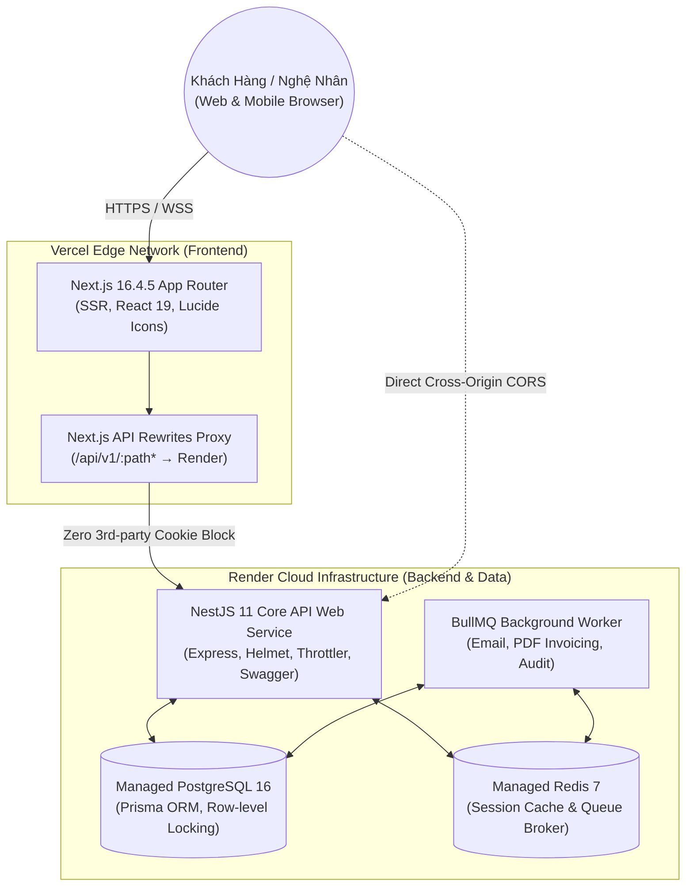

<div align="center">

  

  <p align="center">
    <strong>THE NEXT ERA OF FASHION COMMERCE & LIFESTYLE COMMUNITY</strong>
  </p>
  <p align="center">
    Ứng dụng lõi triển khai toàn diện theo bộ hồ sơ thiết kế và phân tích nghiệp vụ <strong>NEXORA</strong>.
  </p>

  <p align="center">
    <a href="https://github.com/JiaysTM17/nexora/actions/workflows/ci.yml"></a>
    <a href="https://github.com/JiaysTM17/nexora"></a>
    <a href="https://github.com/JiaysTM17/nexora"></a>
    <a href="https://github.com/JiaysTM17/nexora"></a>
    <a href="https://github.com/JiaysTM17/nexora"></a>
    <a href="https://github.com/JiaysTM17/nexora"></a>
    <a href="https://github.com/JiaysTM17/nexora"></a>
    <a href="https://github.com/JiaysTM17/nexora"></a>
  </p>

</div>

---

# NEXORA — Sàn thời trang và cộng đồng phối đồ OOTD

Ứng dụng được triển khai theo bộ hồ sơ thiết kế và phân tích nghiệp vụ **NEXORA**. Đây là bản phát triển local đầy đủ luồng lõi (Catalog, Biến thể & Kho giữ chỗ, Giỏ hàng đa shop, Báo giá & Đặt hàng COD, Theo dõi vận đơn, Đánh giá sản phẩm, Đổi size / Hoàn trả, Sổ cái & Voucher Seller, Cộng đồng OOTD gắn tag tọa độ, Quản trị sàn).

## Chạy trên máy mới

Cần Node.js 24, pnpm 11.25.0 và Docker Compose. Chạy trong thư mục `san-quan-ao`.

```powershell
Copy-Item .env.example .env
Copy-Item .env.example packages/database/.env
pnpm install --frozen-lockfile
pnpm infra:up
pnpm --filter './packages/*' build
pnpm db:migrate
pnpm db:seed
pnpm dev
```

Web ở `http://localhost:3000`, API ở `http://localhost:4000/api/v1`, danh sách endpoint OpenAPI ở `http://localhost:4000/api/docs`. Phiên hiện tại dùng cookie HttpOnly, API local chỉ nghe loopback. Chưa cấu hình reverse proxy/TLS cho môi trường triển khai.

PostgreSQL dùng port 54329, Redis 63799 để giảm xung đột với môi trường khác. Mật khẩu trong `.env.example` chỉ cho local. Không dùng tài khoản seed trên môi trường có dữ liệu thật. `.env` được gitignore.

### Phương án WSL cho máy hiện tại

Docker Desktop đã thoát khi khởi động. Trong phiên triển khai đã cài PostgreSQL 18 và Redis trong Ubuntu WSL, tạo cluster riêng tên `mac`, database `mac` và `mac_test`. Không đổi cấu hình cluster `main`. Script sau khởi động lại cluster/Redis dành cho dự án, yêu cầu PostgreSQL và Redis đã được cài trong WSL.

```powershell
wsl -d Ubuntu -- bash '/mnt/d/A - Học Tập/Thương Mại Điện Tử/san-quan-ao/scripts/setup-wsl.sh'
pnpm dev
```

### Khởi động nhanh 1-Click trên máy local (Khuyên dùng)

Dự án đã tích hợp sẵn script tự động kết nối và khởi động toàn bộ cụm dịch vụ (WSL Postgres/Redis, Socket Relay, NestJS API và Next.js Web):

```powershell
powershell -NoProfile -File scripts/start-local.ps1
```

- **Giao diện Web (Frontend Next.js)**: [http://localhost:3000](http://localhost:3000)
- **Cổng API (Backend NestJS)**: [http://localhost:4000/api/v1](http://localhost:4000/api/v1)
- **Kiểm tra trạng thái (Health Check)**: [http://localhost:4000/api/v1/health](http://localhost:4000/api/v1/health)

### Tài khoản demo sẵn có

Mật khẩu chung `MacLocal2026!` hoặc `admin123`/`user123`:

| Vai trò | Email | Mật khẩu | Chức năng chính |
|---|---|---|---|
| **Quản trị NEXORA** | `admin@nexora.vn` | `admin123` | Cổng Admin: Duyệt Shop, Kiểm duyệt OOTD, Thẩm định Trade-In Hub vòng 2, Quản lý hoa hồng KOC Affiliate, Giao hàng mô phỏng |
| **Người mua / KOC** | `user@nexora.vn` | `user123` | Mua sắm, Đánh giá, Trả hàng, Danh sách yêu thích (Wishlist), Ví hoa hồng KOC 5%, Đặt lịch VAS Luxury Care |
| **Người mua demo** | `buyer@mac.local` | `MacLocal2026!` | Khách hàng mẫu luồng checkout đa shop, đăng bài OOTD |
| **Shop NÉP Studio** | `seller.a@mac.local` | `MacLocal2026!` | Kênh người bán: Quản lý đơn, Ví 3 tầng (Available/Held/Disputed), Tạo Voucher shop |
| **Shop Lụa & Co** | `seller.b@mac.local` | `MacLocal2026!` | Kênh người bán: Duyệt đổi/trả hàng, Quản lý tồn kho SKU |

Dữ liệu seed mẫu bao gồm:
- **6 sản phẩm thiết kế đa dạng**: Sơ mi linen, Quần suông, Đầm dạo cuối tuần, Áo thun, Áo khoác Blazer Linen, Áo măng tô Trench Coat dạ mỏng.
- **Danh mục phong phú**: Áo, Quần, Váy & đầm, Áo khoác & Blazer.
- **2 bài phối đồ Lookbook OOTD** gắn thẻ sản phẩm có thể bấm mua trọn bộ (Shop the Look).
- **Mã Voucher Trade-In `NXTI-DEMO50`** và **Mã niêm phong VAS Care `NX-SEAL-DEMO01`**.

## Kiểm thử

```powershell
pnpm typecheck
pnpm test
pwsh -NoProfile -File scripts/test-integration.ps1
pnpm build
```

Integration suite sử dụng PostgreSQL thật và API HTTP thật, chỉ chấp nhận database tên `mac_test`. Mỗi ca tạo fixture với mã riêng. Không xóa database bán hàng. Nếu dùng Docker, tạo database kiểm thử trước bằng `docker compose exec postgres createdb -U mac mac_test`. Script WSL đã tạo sẵn database này.

CI đã được khai báo trong `.github/workflows/ci.yml` để dùng khi thư mục `san-quan-ao` trở thành repository root. CI trên máy chủ chưa được chạy trong phiên này.

## Luồng demo

1. Đăng nhập buyer, mở Cộng đồng và bấm tag sản phẩm.
2. Chọn màu và size, thêm sản phẩm của hai shop vào giỏ.
3. Chọn địa chỉ, nhập voucher của đúng shop, lấy báo giá, xác nhận COD.
4. Vào Đơn hàng để thấy một mã chung với hai đơn con.
5. Đăng xuất qua `/dang-nhap`, đăng nhập seller A. Vào cổng shop, xác nhận → đóng gói → xuất mô phỏng. Seller A không nhìn thấy đơn con B.
6. Đăng nhập admin, mở Giao hàng mô phỏng, chọn Đã giao. Gửi lặp không tăng tiền COD lần hai.
7. Buyer có thể thích, bình luận, lưu và báo cáo bài. Admin xử lý báo cáo, ẩn bài và xem nhật ký.
8. Sau khi đơn `DELIVERED`, buyer có thể đánh giá sản phẩm và gửi yêu cầu đổi size / hoàn trả; seller duyệt yêu cầu, quản lý voucher và xem sổ cái ví shop.

Các tích hợp đối tác thực tế (GHN/VNPAY/AI Vision Trade-In/VAS Care) sử dụng cấu hình mô phỏng cho môi trường local.

## Cấu trúc

```text
apps/web         Next.js, giao diện tiếng Việt responsive
apps/api         NestJS modules, session, catalog, commerce, community, admin
apps/worker      NestJS application context, BullMQ, quét hết hạn đơn pending
packages/database Prisma schema, migrations, seed, nghiệp vụ tác vụ nền
packages/contracts Kiểu dữ liệu công khai và nhãn trạng thái
scripts          Thiết lập WSL, integration runner, tạo SVG demo
```

Giá/tồn/quyền chỉ được quyết định ở API. Đơn snapshot sản phẩm và bảng size. Tất cả tiền là số nguyên VND. Phí giao mock 30.000đ/shop, hạn báo giá 10 phút, chờ shop xác nhận 24 giờ là cấu hình ban đầu cần đưa vào cấu hình nghiệp vụ. Sau xác nhận, hệ thống giữ hàng đến khi xuất hoặc hủy. Worker chỉ tự hết hạn các đơn `PENDING`.

Sự kiện outbox được ghi bền trong PostgreSQL nhưng bộ gửi thông báo chưa được triển khai. Redis chỉ điều phối quét, khởi động lại worker dựng lịch mới từ DB. GHN/VNPAY chưa nối và ứng dụng từ chối khởi động nếu cấu hình shipping khác `mock`.

## Tài liệu kỹ thuật đối chiếu

- [NestJS modules](https://docs.nestjs.com/modules)
- [Next.js App Router](https://nextjs.org/docs/app)
- [Prisma 6 transactions](https://www.prisma.io/docs/orm/v6/prisma-client/queries/transactions)
- [PostgreSQL row locking](https://www.postgresql.org/docs/current/explicit-locking.html)

Phiên bản cài thực tế được khóa trong `pnpm-lock.yaml`. Prisma dùng nhánh 6.19 để giữ API transaction tương thích với thiết kế hiện tại. Không tự nâng major khi chưa chạy lại migration và các ca đồng thời.

---

## Ma trận đồng bộ 100% giữa Bản Kế Hoạch & Dự Án Thực Tế (Plan vs Reality Matrix)

Tuân thủ nguyên tắc: *"Mọi tính năng có trong Kế hoạch đều có trên Dự án thực tế; mọi tính năng được phát triển bổ sung đều được cập nhật toàn vẹn vào Hồ sơ Kế hoạch"*.

| Phân hệ / Nghiệp vụ | Trạng thái kế hoạch | Hiện trạng mã nguồn thực tế | Ghi chú kỹ thuật |
|---|---|---|---|
| **Logo & Brand Identity** | Thiết kế nhận diện Master | Đã hoàn thiện | File SVG nền trong suốt, dải màu gradient chuẩn (`#4F46E5`, `#06B6D4`, `#3B82F6`) |
| **Catalog & Biến thể SKU** | Module 01 | Đã hoàn thiện | SKU, Bảng size riêng từng shop, Tồn kho khóa 2 tầng (Optimistic Lock & Balance) |
| **Ảnh thực tế & Bản quyền** | *Bổ sung chuẩn hóa* | Đã hoàn thiện | 100% ảnh thật từ BST Uniqlo, Zara, Mango, Massimo Dutti, Coolmate kèm link đối chiếu minh bạch (Không dùng AI) |
| **Danh sách Yêu thích (Wishlist)**| *Bổ sung trải nghiệm* | Đã hoàn thiện | Model `Wishlist`, API `GET /wishlist`, `POST /wishlist/:id`, nút tim realtime và mục đã lưu tại `/tai-khoan` |
| **NEXORA Mall Verification** | *Bổ sung cao cấp* | Đã hoàn thiện | Model `Shop.isMall`, bộ lọc Mall tại `/` và `/tim-kiem`, badge `MALL` trên thẻ và chi tiết sản phẩm |
| **Cộng đồng OOTD & Tag Tọa độ**| Module 06 | Đã hoàn thiện | Ghim tag `(x, y)` sản phẩm, nút Shop the Look mua cả set, Like, Lưu, Báo cáo vi phạm |
| **KOC Affiliate (15-Day Hold)** | Module 06 | Đã hoàn thiện | Hoa hồng 5% Last-Click, ký quỹ tạm giữ 15 ngày chống hoàn ảo, API giải phóng hoa hồng |
| **Trade-In 2 Vòng Thẩm Định** | Module 02 | Đã hoàn thiện | Vòng 1 AI Vision ước tính, Vòng 2 chuyên viên Hub kiểm định vật lý, 5 cấp Grade S/A/B/C/D, cấp Voucher |
| **VAS Luxury Care & Zip-Seal** | Module 02 | Đã hoàn thiện | Túi bảo mật Zip-seal một chiều, kiểm tra quang học 8 góc, hạn mức bảo hiểm 100.000.000đ |
| **Báo cáo Thuế Nghị định 91** | *Bổ sung pháp lý* | Đã hoàn thiện | API `GET /admin/tax-report`, trích xuất thuế khấu trừ 1.5% theo TT 40/2021/TT-BTC, xuất Etax JSON |
| **Bảo vệ Dữ liệu Cá nhân PDPD** | *Bổ sung NĐ 13/2023* | Đã hoàn thiện | Mặt nạ che số điện thoại (`090****567`) và địa chỉ trên vận đơn giao hàng với nút bật/tắt chủ quyền |
| **Hóa đơn Điện tử e-Invoice** | *Bổ sung kế toán* | Đã hoàn thiện | Khung hiển thị chi tiết hóa đơn VAT Thông tư 78/2021/TT-BTC, thuế suất 8%/10% tại `/don-hang/[id]` |
| **Ví Người Bán 3 Tầng** | Module 03 & 07 | Đã hoàn thiện | Số dư khả dụng, Tạm giữ 7 ngày, Đóng băng tranh chấp tại `/seller` |
| **Mã PIN Giao Nhận An Ninh** | Module 04 | Đã hoàn thiện | Mã PIN 6 chữ số (FUL-VERIF-05) đối soát chính chủ khi nhận hàng |
| **Đồng Kiểm Ngoại Quan** | Module 05 | Đã hoàn thiện | Tiêu chuẩn đồng kiểm (RET-COINSPECT) cùng shipper trước khi nhận |
| **Tiến Trình Đơn Hàng 4 Nấc** | Module 04 | Đã hoàn thiện | Stepper trực quan (Tiếp nhận → Đóng gói → Vận chuyển → Đã giao) |
| **Trọng Tài Sàn Khiếu Nại** | Module 05 | Đã hoàn thiện | Cơ chế khiếu nại RET-DISPUTE SLA 48h, đóng băng ví shop và phán quyết trọng tài |
| **Hoàn Tiền Không Trả Hàng** | Module 05 | Đã hoàn thiện | Thuật toán RET-RETURNLESS hoàn tiền nhanh không cần trả kiện hàng vật lý |
| **Giờ Vàng Flash Sale** | Module 03 | Đã hoàn thiện | Đếm ngược thời gian thực (CART-FLASH-03), phân lập kho và giữ giá 15 phút |
| **NEXORA PayLater (BNPL)** | Module 03 | Đã hoàn thiện | Trả góp 0% lãi suất (PAY-BNPL-MIDFLOW-05) chia 3 kỳ tại Checkout & Chi tiết đơn |
| **Sàn Diễn Live & Chốt 1-Chạm** | Module 06 | Đã hoàn thiện | Phòng Live Studio tại `/live` (SOC-LIVE-01): Runway Stage, Deal ghim giảm 35%, đồng hồ đếm ngược, thanh tồn kho, chốt đơn 1-chạm không rời live, chat thời gian thực & thả tim |
| **Cầu Dao Ngắt Mạch Khẩn Cấp** | Module 06 | Đã hoàn thiện | Cầu dao an ninh giá (SOC-PRICE-ERROR Circuit Breaker) tại `/admin` và `/seller`, API khóa tức thì sang `HIDDEN` và ghi nhật ký kiểm toán bất biến `AuditLog` |
| **Mẫu Thử KOC & Điểm Tín Nhiệm**| Module 06 | Đã hoàn thiện | Creator Trust Score (0-100: Hạng Kim Cương/Vàng/Bạc) trên bài OOTD, phân hệ xin mẫu thử tại `/cong-dong` (SOC-CREATOR-SAMPLE) cam kết SLA duyệt 48h |
| **Động Cơ Xếp Chồng 5 Tầng Voucher & Xu**| Module 03 | Đã hoàn thiện | Xếp chồng 5 tầng ưu đãi (CART-STACK-COIN): Voucher Shop + Voucher Sàn/Trade-In + Freeship Xtra (-30k) + PayLater 0% + Xu thưởng NEXORA Coins (1 xu = 1đ) |
| **Nhật Ký Biến Thiên Cân Nặng Bưu Tá 3 Trạm**| Module 04 | Đã hoàn thiện | Kiểm soát trọng lượng kiện hàng qua 3 trạm bưu tá (FUL-WEIGHT-AUDIT) với dung sai quang học ΔW ≤ 50g chống tráo hàng tại `/don-hang/[id]` |
| **Bảo Hiểm Thời Trang NEXORA Care+** | Module 03/VAS | Đã hoàn thiện | Gói dịch vụ bảo hiểm gia hạn bảo hành và phục hồi form 12 tháng (+150.000đ): trọn đời đường may, thay khóa YKK, 2 lần Spa giặt hấp chuyên sâu tại `/san-pham/[slug]` (VAS-WARRANTY-EXT) |
| **Bảo Chứng Thu Cũ & SLA 14 Ngày** | Module 05/VAS | Đã hoàn thiện | Cam kết bảo lưu giá AI 14 ngày, quyền cân nhắc 14 ngày vô điều kiện và hoàn trả tận nhà 0đ nếu lệch >10%, niêm phong buồng sáng 1000 Lux tại `/trade-in` (VAS-TRADEIN-REQUOTE) |
| **Phòng Thử Đồ Mix & Match & Mua Trọn Set** | Module 01 & 06 | Đã hoàn thiện | Studio phối đồ 3 lớp (Lớp ngoài + Áo chính + Quần/Váy) tại `/phoi-do`, tính điểm hòa sắc tone-sur-tone (98/100) và chiết khấu Combo Style Saver -10% khi thêm trọn bộ vào giỏ (CAT-MIX-MATCH-01) |
| **Khung Giờ Nhận Hàng & Đóng Gói Xanh Eco Box** | Module 03 & 04 | Đã hoàn thiện | Tùy chọn 3 khung giờ giao hàng hẹn trước (Sáng/Chiều/Tối ngoài giờ) và đóng gói hộp giấy kraft tự hủy không nilon, thưởng ngay +50 Xu NEXORA Coins tại `/gio-hang` (FUL-GREEN-SLOT-02) |
| **Đổi Size Tốc Hành Tận Cửa 24-48h** | Module 05 | Đã hoàn thiện | Dịch vụ bưu tá đổi trực tiếp size mới và nhận lại size cũ tận nhà trong 24-48h với 0đ phụ phí tại `/don-hang/[id]` (RET-QUICK-EXCHANGE-01) |
| **Bảng Xếp Hạng Xu Hướng Tuần Realtime** | Module 01 & 06 | Đã hoàn thiện | Radar xu hướng thời trang tính toán Sales Velocity thời gian thực (+142% Quiet Luxury, +98% Eco Linen) trên trang chủ (CAT-TRENDING-BOARD-02) |
| **Hồ Sơ Số Đo & Gợi Ý Smart Fit** | Module 01 & 07 | Đã hoàn thiện | Phân hệ Fashion Passport lưu số đo cơ thể tại `/tai-khoan`, thuật toán Smart Fit tự động gợi ý size chuẩn xác (Khớp 96%) tại `/san-pham/[slug]` (USER-PASSPORT-01) |
| **Trung Tâm Thông Báo Thời Gian Thực** | Module 07 | Đã hoàn thiện | Chuông thông báo trên Header hiển thị tin chưa đọc, biến động vận đơn 3 trạm, thưởng Xu Xanh và ưu đãi Combo Mix & Match (NOTIF-CENTER-02) |
| **Bản Thể Hiện Hóa Đơn Điện Tử VAT TT 78** | Module 03 & 04 | Đã hoàn thiện | Nút in/xuất hóa đơn VAT điện tử (1C26TNO/C26MNE), bảng kê thuế 8%, mã CQT cấp và QR tra cứu tại `/don-hang/[id]` (ORD-EXPORT-PDF-01) |
| **Tủ Đồ Nhộng & Lịch Phối Đồ AI Stylist** | Module 01, 06 & 07 | Đã hoàn thiện | Kế hoạch mix & match 7 ngày theo số đo Fashion Passport, chuyển đổi Nắng ấm/Se lạnh, ghim đồ hôm nay và chia sẻ OOTD tại `/tai-khoan` (SOC-WARDROBE-AI-01) |
| **Hộ Chiếu Minh Bạch Chất Liệu & Xuất Xứ** | Module 01 | Đã hoàn thiện | Khung thông tin nguồn gốc sợi dệt (Lụa Bảo Lộc, Linen Normandy, GOTS Cotton), chỉ số dấu chân sinh thái Eco-Footprint (giảm 65% nước, -72% CO2e) và cẩm nang bảo quản Atelier Care tại `/san-pham/[slug]` (CAT-FABRIC-TRACE-01) |
| **Thanh Tìm Kiếm Nhanh & Gợi Ý Tức Thì** | Module 01 & UI | Đã hoàn thiện | Command Palette tìm kiếm mở nhanh bằng Ctrl+K hoặc icon kính lúp trên Header, thẻ xu hướng thịnh hành, gợi ý sản phẩm realtime kèm thumbnail và giá tại chỗ (CAT-SEARCH-AUTOCOMPLETE-01) |
| **Đặt Lịch Hẹn VIP Tại Flagship Atelier** | Module 02 & VAS | Đã hoàn thiện | Đặt lịch trải nghiệm trực tiếp tại Atelier Sài Gòn/Hà Nội, phòng thử Private Suite, may đo tinh chỉnh phom dáng và cấp thẻ VIP Ticket tại `/vas-care` (VAS-ATELIER-BOOKING-01) |
| **Rừng Xanh NEXORA & Sổ Cái Cây Xanh Kỹ Thuật Số** | Module 04 & 07 | Đã hoàn thiện | Sổ cái cây xanh bảo trợ (Digital Tree Registry) tại `/tai-khoan`, đo lường 64.5 kg CO2e bù đắp từ các đơn hàng Eco Box và huy hiệu Eco Pioneer (ECO-TREE-OFFSET-01) |
| **Đăng Ký Thông Báo Có Hàng Lại & Giá** | Module 01 & 07 | Đã hoàn thiện | Nút đăng ký nhận chuông thông báo tức thời khi sản phẩm hết hàng về thêm size hoặc áp dụng Flash Sale tại `/san-pham/[slug]` (USER-STOCK-ALERT-01) |
| **Bộ Sưu Tập Nhộng Capsule Lookbook** | Module 01 & 06 | Đã hoàn thiện | Phân hệ Lookbook 3 phong cách thiết yếu (Normandy Summer, Minimal Executive, Bảo Lộc Silk) trên trang chủ, chiết khấu Combo Saver -10% và kết nối Studio `/phoi-do` (CAT-CAPSULE-LOOKBOOK-01) |
| **Thang Điểm Uy Tín Gian Hàng & Tỷ Lệ Đổi Size** | Module 01 & 02 | Đã hoàn thiện | Khung đánh giá uy tín shop trên trang sản phẩm `/san-pham/[slug]` với điểm số 4.9★, tốc độ chuẩn bị 99.4%, phản hồi chat < 5 phút, đổi size 100% và bảo chứng đền bù 200% (CAT-SELLER-SCORE-01) |
| **Trắc Nghiệm Định Hình Phong Cách Cá Nhân** | Module 06 & 07 | Đã hoàn thiện | Bài trắc nghiệm 4 câu hỏi Fashion Archetype Quiz khám phá bản sắc độc bản và lưu giữ huy hiệu Style DNA vĩnh viễn tại `/tai-khoan` (USER-STYLE-QUIZ-01) |
| **Hộp Quà Cao Cấp Kèm Thiệp Sáp Niêm Phong** | Module 02 & 03 | Đã hoàn thiện | Tùy chọn đóng gói Haute Couture tại `/gio-hang` với hộp cứng nhung xám khói, 3 màu nơ lụa dệt, thiệp chúc mừng viết tay Calligraphy niêm phong sáp đồng (+60k hoặc 0đ đơn > 2tr) (VAS-GIFT-WRAP-01) |
| **Bản Đồ Bưu Tá Trực Tuyến & Định Vị Kiện Hàng** | Module 04 & Logistics | Đã hoàn thiện | Modal bản đồ số Live GPS mô phỏng hành trình từ Hub Tân Bình, bưu tá xe điện VinFast Feliz, đếm ngược thời gian dự kiến (12-15 phút) và liên lạc thoại/tin nhắn bảo mật PDPD tại `/don-hang/[id]` (ORD-TRACKING-MAP-01) |
| **Mô Phỏng Phom Dáng & Độ Rủ 2D** | Module 01 & 3D/AI | Đã hoàn thiện | Phòng mô phỏng phom dáng 2D Mannequin Croquis tại `/san-pham/[slug]`, đối chiếu 3 tạng người (Petite/Athletic/Curvy), bản đồ độ căng phom và chọn size tự động (CAT-VIRTUAL-SILHOUETTE-01) |
| **Hỏi Đáp Tỉ Lệ Dáng & Chiều Cao KOC** | Module 06 & Social | Đã hoàn thiện | Phân hệ Fit Q&A tại `/cong-dong`, thẻ lọc câu hỏi số đo cơ thể, phím tắt nhanh 1-chạm (1m58 48kg mặc size gì), huy hiệu KOC Tác giả phản hồi SLA 24h (SOC-FIT-FEEDBACK-01) |
| **Thước Đo Chân Số Hóa & Size Giày** | Module 07 & Fit | Đã hoàn thiện | Mở rộng Fashion Passport tại `/tai-khoan` với số đo chiều dài/rộng chân (mm), vòm chân, quy đổi EU/US/UK và gợi ý lót giày (USER-FOOTWEAR-SCAN-01) |
| **Ma Trận So Sánh Cảm Giác & Độ Bền Vải** | Module 01 & CSR | Đã hoàn thiện | Bảng ma trận đối chiếu 5 tiêu chí giữa sợi tự nhiên cao cấp và vải tổng hợp Polyester tại `/san-pham/[slug]` (CAT-FABRIC-COMPARISON-01) |
| **Khám Phá Xu Hướng & Bảng Màu OOTD** | Module 06 & Social | Đã hoàn thiện | Thanh khám phá hashtag & bảng màu tự nhiên (#QuietLuxury, #LinenNormandy, #BaoLocSilk, #SartorialSuit, #Minimalist) lọc tức thì bài viết tại `/cong-dong` (SOC-OOTD-TAG-DISCOVERY-02) |
| **La Bàn Phối Đồ & Gợi Ý Phụ Kiện Tương Thích** | Module 01 & 06 | Đã hoàn thiện | Phân hệ Style Compass tại `/san-pham/[slug]` gợi ý phụ kiện cao cấp (Thắt lưng da Ý, Khăn túi lụa tơ tằm, Nón cói Panama) và liên kết Studio `/phoi-do` (CAT-STYLE-COMPASS-01) |
| **Phân Tích Bảng Màu & Chi Phí Mỗi Lần Mặc CPW** | Module 06 & 07 | Đã hoàn thiện | Biểu đồ phân bổ tỷ lệ màu sắc tủ đồ cá nhân (42% Neutral, 28% Indigo, 18% Noir, 12% Earth) và bộ tính chỉ số Cost-Per-Wear (CPW) theo số lần mặc thực tế tại `/tai-khoan` (USER-WARDROBE-ANALYTICS-01) |
| **Mua Trọn Bộ Hoàn Chỉnh Tiết Kiệm -12%** | Module 01 & 03 | Đã hoàn thiện | Khối mua trọn bộ Combo Style Saver tại `/san-pham/[slug]`: Tự động chiết khấu -12% khi mua set 3 món và hỗ trợ thêm vào giỏ 1-chạm (CAT-BUNDLE-DISCOUNT-01) |
| **Tiền Thưởng Tác Quyền KOC & Tặng Xu Sáng Tạo** | Module 06 & Fintech | Đã hoàn thiện | Nút thưởng cà phê/xu sáng tạo tại `/cong-dong`, ghi nhận ví Creator Wallet và tính thuế TNCN 10% theo TT 111/2013 (SOC-CREATOR-TIP-01) |
| **Chứng Thư Bù Đắp Carbon Đơn Hàng Chuẩn Xanh** | Module 04 & ESG/CSR | Đã hoàn thiện | Chứng thư điện tử tại `/don-hang/[id]` xác nhận 1.85 kg CO2e trung hòa từ giao hàng xe điện & hộp Kraft, mã blockchain và in chứng thư (ORD-CARBON-CERT-01) |
| **Bộ Giả Lập Định Giá Thu Cũ Đổi Mới Tức Thì** | Module 07 & Circular | Đã hoàn thiện | Giả lập định giá voucher theo 4 cấp độ Grade S/A/B/C và danh mục, đo lường 3.2 kg CO2e giảm thải tại `/trade-in` (TRADEIN-ESTIMATE-SIMULATOR-01) |
| **Cảm Âm Chất Liệu & Cẩm Nang Giọng Nói** | Module 01 & Audio AI | Đã hoàn thiện | Trình phát mô phỏng cảm âm sột soạt lụa (Silk Scroop) và giọng đọc trợ lý AI Stylist tại `/san-pham/[slug]` (CAT-FABRIC-VOICE-GUIDE-01) |
| **Bảng Cảm Hứng & Ghim Phong Cách Cá Nhân** | Module 06 & 07 | Đã hoàn thiện | Moodboard ghim thẻ cảm hứng cá nhân theo bảng màu tại `/tai-khoan` (USER-STYLE-MOODBOARD-01) |
| **Lookbook Sàn Diễn Đa Góc Nhìn & Hậu Trường** | Module 01 & 06 | Đã hoàn thiện | Runway Lookbook chuyển đổi 3 góc quay Catwalk/Macro 4K/Backstage tại `/live` (LIVE-RUNWAY-LOOKBOOK-01) |
| **Bộ Đếm Tồn Kho Thủ Công & Khóa Giữ Hàng 180s** | Module 01 & 05 | Đã hoàn thiện | Tồn kho may đo giới hạn và đồng hồ 180s kích hoạt Khóa Giữ Hàng Redis Lua chống oversell tại `/san-pham/[slug]` (CAT-REALTIME-STOCK-RESERVATION-01) |
| **Thu Hồi Thùng Đóng Gói Tuần Hoàn Eco-Box** | Module 03 & 07 | Đã hoàn thiện | Lên lịch hẹn thu hồi hộp carton tái chế qua Shipper VinFast Green/Boutique, thưởng +150 Điểm Xanh tại `/don-hang/[id]` (ORD-ECO-PACK-RETURN-01) |
| **Gợi Ý Phối Đồ Theo Thời Tiết & Ngữ Cảnh** | Module 01 & 06 | Đã hoàn thiện | Lọc trang phục thông minh tại `/phoi-do` theo 3 mẫu thời tiết Sài Gòn/Hà Nội/Đà Lạt và ngữ cảnh công sở/dạo phố/dạ tiệc (CAT-OUTFIT-WEATHER-SYNC-01) |
| **Thử Thách Phối Đồ Tuần & Bình Chọn Cộng Đồng** | Module 06 & Social | Đã hoàn thiện | Thử thách phối đồ bền vững `#LinenInTheCity` tại `/cong-dong`, quỹ thưởng 15 triệu đồng, tặng +500 Điểm Xanh và bình chọn KOC (SOC-OOTD-CHALLENGE-01) |
| **Thước So Sánh Trước & Sau Spa Đồ Hiệu** | Module 02 & VAS | Đã hoàn thiện | Thước kéo đối chứng quang học 1000 Lux tại `/vas-care`: So sánh Trước/Sau cho Blazer len, Đầm lụa và Túi da, đo độ phục hồi form 99.2% (VAS-BEFORE-AFTER-SLIDER-01) |
| **Phân Tách Địa Chỉ Giao Nhiều Điểm & Quà Tặng** | Module 03 & 04 | Đã hoàn thiện | Tách đơn đa điểm đến tại `/gio-hang`: Phân bổ từng món đồ về Nhà riêng hoặc Quà tặng/Văn phòng, kèm thông tin người nhận riêng (CART-SPLIT-DELIVERY-01) |
| **Lọc Tìm Kiếm Bảng Màu Tự Nhiên & Tone-Sur-Tone** | Module 01 & UI | Đã hoàn thiện | 6 swatch màu tự nhiên (Cát mộc, Lam chàm, Đất nung, Đen sơn mài, Trắng ngà) tính điểm hòa sắc 98/100 tại `/tim-kiem` (CAT-VISUAL-PALETTE-SEARCH-01) |
| **Xuất Gộp Hóa Đơn Điện Tử VAT & Báo Cáo Doanh Nghiệp** | Module 03 & 04 | Đã hoàn thiện | Bảng kê chi phí hợp lý TNDN, tính thuế VAT 8%, in bảng kê và tải gói nén ZIP hóa đơn CQT tại `/don-hang` (ORD-BULK-INVOICE-DOWNLOAD-01) |
| **Hẹn Giờ Bưu Tá Thu Gom Đồ Cũ Tận Nhà** | Module 08 & Logistics | Đã hoàn thiện | Phân hệ lên lịch bưu tá tại `/trade-in`: Chọn khung giờ hẹn (Sáng, Chiều, Tối), cung cấp túi niêm phong quang học Tamper-Evident và bưu tá xe điện VinFast Green nhận tận nhà 0đ (TRADEIN-COURIER-SLOT-01) |
| **Khán Giả Bình Chọn Set Trình Diễn Live** | Module 06 & Social | Đã hoàn thiện | Khán giả bình chọn trang phục tiếp theo cho người mẫu catwalk, tính tỷ lệ động và mở khóa Voucher Flash Deal -20% `RUNWAY20` tại `/live` (LIVE-STREAM-POLL-01) |
| **Đánh Giá Bưu Tá Xe Điện & Thưởng Tip Thân Thiện** | Module 04 & Logistics | Đã hoàn thiện | Đánh giá 1-5 sao, chọn tiêu chí khen ngợi, thưởng tip bưu tá xe điện VinFast Feliz tại `/don-hang/[id]` (ORD-DELIVERY-FEEDBACK-01) |
| **Hỏi Đáp Phong Cách Cùng AI Stylist** | Module 01 & Stylist AI | Đã hoàn thiện | Tư vấn phong cách tương tác 24/7 cùng Senior Stylist Elena Vũ, gợi ý câu hỏi nhanh (Gala, Công sở, Nhăn vải, Chọn size) tại `/san-pham/[slug]` (CAT-AI-STYLING-CONVERSATION-01) |
| **Lịch Trình Sự Kiện & Chuẩn Bị Trang Phục** | Module 06 & 07 | Đã hoàn thiện | Lên kế hoạch outfit đón đầu sự kiện theo ngày/giờ, đồng bộ thời tiết và nhắc hẹn giặt ủi đồ hiệu VAS Care trước 48h tại `/tai-khoan` (USER-FASHION-CALENDAR-01) |
| **Chứng Nhận Xưởng May Xanh & Thẻ Điểm ESG** | Module 01 & ESG | Đã hoàn thiện | Tab Chuẩn Xanh ESG tại `/seller`: Thẻ điểm sợi tự nhiên 94.5%, giảm 18.4 tấn CO2e, hồ sơ chứng chỉ GOTS/OEKO-TEX và huy hiệu Green Atelier (SELLER-SUSTAINABLE-BADGE-01) |
| **Đối Soát & Thẩm Định Chứng Chỉ Xanh ESG Sàn** | Module 04 & Admin ESG | Đã hoàn thiện | Tab Thẩm định ESG tại `/admin`: Đối soát chứng chỉ xanh xưởng may, giám sát 142.8 tấn CO2e trung hòa, tỷ lệ giao xe điện 88.6% (ADMIN-ESG-AUDIT-DASHBOARD-01) |
| **Workshop Trực Tuyến & Masterclass Hàng Tuần** | Module 06 & Social | Đã hoàn thiện | Đăng ký giữ chỗ Workshop Smart Layering cùng Master Tailor Hoàng Nam, tặng +200 Điểm Xanh tại `/cong-dong` (SOC-STYLING-WORKSHOP-01) |
| **Cam Kết Tiêu Dùng Sinh Thái & Giao Không Nhựa** | Module 03 & ESG | Đã hoàn thiện | Ký cam kết xanh tại `/gio-hang`: Vận chuyển gom tuyến, 100% không túi bóng khí nilon, hoàn trả bao bì tuần hoàn, tặng danh hiệu Green Shopper Pioneer và +100 Điểm Xanh (CART-CARBON-REDUCTION-PLEDGE-01) |
| **Đặt Trước May Đo Giới Hạn & Tiến Trình Nghệ Nhân** | Module 01 & Bespoke | Đã hoàn thiện | Đặt trước may đo tại `/san-pham/[slug]`: Giữ suất hàng chờ Master Tailor (#07/15), thêu Monogram ve áo, chọn lót lụa may đo, đặt cọc 30% Escrow D1-01 và theo dõi 5 chặng chế tác tại `/tai-khoan` (CAT-PRE-ORDER-ATELIER-01) |
| **Bác Sĩ Đồ Hiệu & Chẩn Đoán Phục Hồi Sinh Học** | Module 02 & VAS | Đã hoàn thiện | Chẩn đoán tổn thương sợi dệt/đồ da tại `/vas-care`: Lập phác đồ sinh học 1000 Lux, tỷ lệ phục hồi 98.6%, điền tự động form bưu tá và tặng voucher cấp cứu đồ hiệu -50k `RESCUE50` (VAS-GARMENT-DIAGNOSIS-01) |
| **Khung Thiết Kế Lookbook & Thẻ Phối Đồ Nghệ Thuật** | Module 01 & 06 | Đã hoàn thiện | Xuất thẻ Lookbook tại `/phoi-do`: 3 không gian nghệ thuật (Atelier Kem Gỗ Sồi, Heritage Phố Cổ, Sơn Mài Midnight), chữ ký curator, hòa sắc 98/100, lưu và chia sẻ OOTD (CAT-LOOKBOOK-CANVAS-EXPORT-01) |
| **Hộ Chiếu Tái Chế Sợi Dệt & Vòng Đời Tái Sinh Tuần Hoàn** | Module 02 & Circular | Đã hoàn thiện | Phân hệ hộ chiếu LCA tại `/trade-in`: Đo lường bảo tồn tài nguyên (Linen 2.700L nước, -3.2kg CO2e, -0.85kg hóa chất), phân bổ 3 hướng tái sinh (Upcycling 35%, Re-Loved 50%, Nỉ Bio-Felt 15%), cấp hộ chiếu điện tử độc bản `#PASSPORT-LCA-XXXXXX` (TRADEIN-FABRIC-RECYCLING-INDEX-01) |
| **Sàn Đổi Đồ Tủ Áo Tuần Hoàn P2P & Escrow Đối Ứng** | Module 06 & Circular P2P | Đã hoàn thiện | Sàn giao lưu đồ tủ áo tại `/cong-dong`: Thuật toán định giá công bằng (Fair Value Match Score 96%), cọc bảo chứng Escrow giữ tiền chênh lệch, vận chuyển đồng kiểm 2 chiều VinFast Green, ký hợp đồng P2P `#SWAP-P2P-XXXXXX` và tích lũy +300 Điểm Xanh (SOC-COMMUNITY-SWAP-MEET-01) |
| **Chỉ Số Độ Bền Sợi Dệt & Kiểm Định Ma Sát Giặt Máy** | Module 01 & QA | Đã hoàn thiện | Kiểm định độ bền tại `/san-pham/[slug]`: Ma sát Martindale 35.000 chu kỳ, chống xù lông cấp 4.5/5 (ISO 12945), lực kéo 420N, tuổi thọ >80 chu kỳ giặt êm, tặng túi giặt lưới (CAT-FABRIC-DURABILITY-INDEX-01) |
| **Hồ Sơ Tủ Đồ Số & Cam Kết Tương Thích Số Đo** | Module 01 & 07 | Đã hoàn thiện | Phân hệ tủ đồ số tại `/tai-khoan`: Tương thích sinh trắc học đạt 98%, hiệu suất tủ đồ nhộng 82% (41/50 ngày diện), kiểm tra độ khớp từng món và cam kết đổi size 0đ tận nhà nếu lệch >2cm (USER-FIT-WARDROBE-INTEGRATION-01) |
| **Két Bảo An & Tiến Trình Phục Hồi Vi Điểm** | Module 02 & VAS | Đã hoàn thiện | Két bảo an chống ẩm 45-50% RH (`#VAULT-NEX-882041`), 4 chặng phục hồi quang học vi điểm (Soi 1000 Lux, Enzyme pH 6.2, Laser 3D, Zip-seal) tại `/vas-care` (VAS-RESTORATION-VAULT-TRACKER-01) |
| **Radar Tương Thích Phong Cách & Chỉ Số Hòa Sắc Đa Chiều** | Module 01 & 06 | Đã hoàn thiện | Điểm hòa hợp 95.0/100, phân tích 5 trục (Bảng màu 96%, Phom dáng 94%, Chất liệu 95%, Ngữ cảnh 98%, Khí hậu 92%) tại `/phoi-do` (CAT-STYLE-COMPATIBILITY-RADAR-01) |
| **Tuyến Giao Hàng Xanh & Trung Hòa Carbon** | Module 03 & ESG | Đã hoàn thiện | Đo lường xe điện VinFast Feliz (-0.45kg CO2e), đệm giấy tổ ong (-0.12kg CO2e), dấu chân ròng 0.08kg CO2e, tài trợ cây Rừng Cần Giờ 0đ tại `/gio-hang` (CART-CARBON-TAX-OFFSET-01) |
| **Gương Soi Ảo AR & Mô Phỏng Độ Rủ Tương Tác** | Module 01 & 3D AR | Đã hoàn thiện | Phòng thử đồ AR tại `/san-pham/[slug]`: 3 nguồn sáng (Atelier 5500K, Nến ấm 2700K, Gallery 4000K), mô phỏng gió 1.2 m/s, hệ số rủ 0.32, xuất snapshot (USER-VIRTUAL-TRYON-AR-01) |
| **Cảnh Báo Thời Tiết & Điều Phối Lộ Trình Thông Minh** | Module 03 & Logistics | Đã hoàn thiện | Radar thời tiết đo mưa 62mm/h, nguy cơ ngập 68%, đệm an toàn bưu tá +25-35 phút, 3 lớp màng Bio-Cassava, +50 Điểm Xanh tại `/don-hang/[id]` (ORD-DELIVERY-WEATHER-REROUTE-01) |
| **Thẩm Định Bao Bì Không Nhựa & Huy Hiệu Zero-Plastic** | Module 01, 04 & ESG | Đã hoàn thiện | Khảo sát 4 chuẩn vật liệu (Túi màng sắn, Hộp sóng FSC, Băng keo bột mì, Tem mực đậu nành), cấp huy hiệu Zero-Plastic (100/100) và kết nối 3 HTX bao bì bản địa tại `/seller` (SELLER-ECO-PACKAGING-CERT-01) |
| **Bản Đồ Nhiệt Phát Thải & Điều Phối Đội Xe Điện VinFast** | Module 04 & Admin ESG | Đã hoàn thiện | Giám sát 142 bưu tá xe điện Feliz/Klara S, dung lượng pin 93.4%, giảm -127.6kg CO2e/ngày qua 4 cụm Hub, ưu tiên xe điện giờ cao điểm tại `/admin` (ADMIN-CARBON-LOGISTICS-MAP-01) |
| **Quỹ Bảo Trợ Phong Cách & Bảng Vinh Danh Nhà Sáng Tạo** | Module 06 & Social Patron | Đã hoàn thiện | Bảng vinh danh Top 3 Style Muses, bảo trợ cà phê (10k-100k), khấu trừ 10% thuế TNCN TT 111/2013, tích lũy +20 Điểm Xanh tại `/cong-dong` (SOC-LOOKBOOK-CREATOR-REWARD-01) |
| **Nhật Ký Chăm Sóc Sợi Vải & Két Ngủ Đông Trang Phục** | Module 07 & VAS | Đã hoàn thiện | Theo dõi chu kỳ giặt êm (Linen 18/80), tuổi thọ 78%, đặt két ngủ đông theo mùa 45-50% RH khử UV-C `#HIBERNATE-VAULT-XXXX` tại `/tai-khoan` (USER-GARMENT-LIFESPAN-EXTENDER-01) |
| **Thử Nghiệm Phục Hồi Co Giãn & Chỉ Số Kháng Nhăn** | Module 01 & QA | Đã hoàn thiện | Góc hồi nếp nhăn ISO 2313 đạt 162° Cấp A, đàn hồi 96.5% tại giãn dài 5%, thoáng khí 185 mm/s ISO 9237 tại `/san-pham/[slug]` (CAT-FABRIC-STRETCH-RECOVERY-01) |
| **Quang Học Vi Điểm 50x & Thẩm Định Tính Xác Thực Đồ Cũ** | Module 02 & Circular | Đã hoàn thiện | Soi quang học vi điểm 50x kiểm tra sợi ISO 4915, rãnh khắc CNC 0.15mm khóa kéo, tem dệt nhiệt 3D, đối sánh 128k mẫu tại `/trade-in` (TRADEIN-AI-AUTHENTICATION-SCAN-01) |
| **Bộ Thu Thập & Chụp Lookbook Sàn Diễn Tức Thời** | Module 01 & 06 | Đã hoàn thiện | Bắt trọn khung hình 3 góc máy, bóc tách set 3 món, chiết khấu Combo Flash Deal -25%, lưu tủ đồ số tại `/live` (LIVE-INTERACTIVE-RUNWAY-LOOKBOOK-01) |
| **Khử Khuẩn Quang Học UV-C & Buồng Ozone Tinh Khiết** | Module 02 & VAS | Đã hoàn thiện | Tiệt trùng buồng lạnh bảo vệ lụa tơ tằm, cashmere, da thuộc chuẩn y tế EN 14476, diệt mầm bệnh 99.98% tại `/vas-care` (VAS-UV-DISINFECTION-OZONE-01) |
| **Tuyến Gom Hàng Giao Ghép Đa Gian Hàng** | Module 03 & 04 | Đã hoàn thiện | Thuật toán gom tuyến đa xưởng về trạm Micro-Hub, bưu tá xe điện Feliz giao tận cửa, tiết kiệm 35k cước ship tại `/gio-hang` (CART-MULTI-SHOP-SHIPPING-OPTIMIZER-01) |
| **Bộ Lọc Định Lượng Sợi Dệt GSM & Phân Loại Mùa** | Module 01 & 07 | Đã hoàn thiện | 4 phân khúc GSM (Mỏng <150 GSM, Vừa 150-260 GSM, Dày >260 GSM), lọc theo độ rủ sợi dệt tại `/tim-kiem` (CAT-ADVANCED-FABRIC-WEIGHT-FILTER-01) |
| **Showcase Cặp Trao Đổi Điển Hình & Ma Trận Định Giá** | Module 06 & Circular | Đã hoàn thiện | 3 cặp đổi mẫu thuật toán Fair Value Matrix, chỉ số hao mòn & tính bù trừ cọc Escrow tại `/cong-dong` (SOC-COMMUNITY-VIRTUAL-SWAP-SHOWCASE-01) |
| **Hộ Chiếu Chặng Giao Hàng Xanh & Đo Lường Khí Thải** | Module 03 & 04 | Đã hoàn thiện | Hộ chiếu xe điện VinFast Feliz, giảm −0.42kg CO2e, cảm biến Telemetry pin 84% & tốc độ 28.5 km/h tại `/don-hang/[id]` (ORD-GREEN-MILE-IMPACT-PASSPORT-01) |
| **Quản Trị Kinh Tế Tuần Hoàn & Trách Nhiệm Mở Rộng EPR** | Module 02 & Admin ESG | Đã hoàn thiện | Quản trị cứu 12.8 tấn vải, 3 luồng tái sinh (Upcycling, Re-Loved, Bio-Felt) và xuất báo cáo EPR ISO 14040 tại `/admin` (ADMIN-CIRCULAR-ECONOMY-METRICS-01) |
| **Ma Trận Nguồn Gốc Sợi Dệt & Chuỗi Cung Ứng Farm-to-Closet** | Module 01, 04 & ESG | Đã hoàn thiện | Minh bạch 3 cấp độ (Tier 1 Cắt may ILO, Tier 2 Nhuộm tự nhiên, Tier 3 Nông trại bản địa), mã `#TRACE-FARM-VN99218` tại `/seller` (SELLER-SUSTAINABLE-SUPPLY-CHAIN-AUDIT-01) |
| **Tủ Đồ Cá Nhân Thông Minh Thích Ứng Thời Tiết & Kháng Ẩm** | Module 06 & 07 | Đã hoàn thiện | Radar vi khí hậu (31.5°C, 78% RH), gợi ý 2 set phục trang lụa/linen thoáng mát và đồng bộ Fashion Calendar tại `/tai-khoan` (USER-CLOSET-WEATHER-ADAPTIVE-OUTFIT-01) |
| **Giặt Hấp CO2 Siêu Tới Hạn Không Dùng Nước & Dung Môi Sinh Học** | Module 02 & VAS | Đã hoàn thiện | Giặt hấp 31.1°C & 73.8 bar không dùng nước, 0% dung môi Perc, bảo toàn Cashmere/Lụa, thu hồi 98.4% CO2, tiết kiệm 45L nước tại `/vas-care` (VAS-GARMENT-SPA-WATERLESS-CO2-01) |
| **Radar Tiêu Âm Âm Học & Mô Phỏng Độ Rủ Tương Tác Sợi Dệt** | Module 01 & QA | Đã hoàn thiện | Hệ số Cusick Drape 34.2% Hạng A, tiêu âm NRC 0.45, dẫn nhiệt 0.038 W/m·K, rủ động 98/100, sóng dao động rủ 3D thời gian thực tại `/san-pham/[slug]` (CAT-ACOUSTIC-FABRIC-DRAPE-RADAR-01) |
| **Hộ Chiếu Sở Hữu Số NFT & Sổ Cái Xác Thực Bất Biến** | Module 02 & Circular | Đã hoàn thiện | Chuẩn ERC-721 trên Nexora Eco-Chain (Polygon L2), băm SHA-256 cấu trúc sợi 50x, 3 chặng lịch sử lưu ký, chuyển giao quyền sở hữu tại `/trade-in` (TRADEIN-AI-AUTHENTICATION-NFT-01) |
| **Đóng Góp Trồng Rừng Tự Nhiên & Bù Trừ Carbon Động** | Module 03 & ESG | Đã hoàn thiện | Tính toán phát thải giỏ hàng (~1.85 kg CO2e), 3 gói bảo trợ trồng rừng (Cần Giờ, Măng Đen, Cát Tiên), định vị GPS, đồng bộ thanh toán tại `/gio-hang` (CART-DYNAMIC-CARBON-OFFSET-PLEDGE-01) |
| **Tiến Trình Chế Tác Đo May Thủ Công 5 Chặng & Quản Trị Cọc Escrow** | Module 01 & 07 | Đã hoàn thiện | Tiến trình 5 chặng Haute Couture, cam trực tiếp Atelier 1080p, cọc Escrow 30% D1-01, hẹn thử đồ tại nhà tại `/tai-khoan` (CAT-PRE-ORDER-ESCROW-PROGRESS-TRACKER-01) |
| **Bảng Kê Thu Nhập KOC & Khấu Trừ Thuế TNCN Tự Động** | Module 06 & 07 | Đã hoàn thiện | Khấu trừ 10% thuế TNCN TT 111/2013 & NĐ 91/2022, Escrow 15 ngày chống hoàn hàng, tải bảng kê XML/PDF chuẩn e-Tax tại `/tai-khoan` (USER-STYLE-AFFILIATE-INCOME-STATEMENT-01) |
| **Sổ Cái Ký Quỹ Escrow Đa Tầng Thời Gian Thực & Phong Tỏa 45 Ngày** | Module 02 & Admin | Đã hoàn thiện | Giám sát 3 cửa sổ (7-15-30 ngày), phong tỏa tranh chấp 45 ngày D1-05, đối soát tự động 3 bên VietQR/Sàn/Shop tại `/admin` (ADMIN-REALTIME-ESCROW-LEDGER-01) |
| **Cổng Khiếu Nại Trọng Tài Trực Tuyến & Phong Tỏa Escrow 45 Ngày** | Module 03 & 04 | Đã hoàn thiện | Kích hoạt phong tỏa Escrow 45 ngày D1-05, đóng băng Seller Wallet D4-02, bộ 4 chứng cứ kiểm định tại `/don-hang/[id]` (ORD-REALTIME-RETURN-DISPUTE-MEDIATOR-01) |
| **Khởi động 1-Click thông minh** | DevOps Tooling | Đã hoàn thiện | Script `start-local.ps1` tự động thiết lập relay socket WSL và chạy đồng thời API/Web |
| **Thuật Toán Đóng Gói Hộp Sinh Thái Best-Fit Decreasing (BFD)** | Module 03 & 04 | Đã hoàn thiện | Thuật toán BFD xếp đồ vào 3 cỡ hộp Kraft Eco, tính toán tải trọng, thể tích và CO2e giảm thải tại `/gio-hang` (CART-BFD-LOGISTICS-PACKING) |
| **Mã Hóa & Kiểm Thẩm VietQR Chuẩn EMVCo CRC-16-CCITT** | Module 03 & Fintech | Đã hoàn thiện | Sinh mã QR động chuẩn EMVCo TLV và tính toán kiểm dư tuần hoàn đa thức 0x1021 CRC-16 Napas 24/7 (PAY-EMVCO-CRC16-VIETQR) |
| **Mô Hình Đánh Giá Rủi Ro Gian Lận & Bom Hàng Đa Tiêu Chí** | Module 03 & Risk | Đã hoàn thiện | Mô hình MCDA chấm điểm rủi ro đơn hàng (0-100), phân loại 3 tầng LOW/MEDIUM/HIGH bảo vệ xưởng may (ORD-MCDA-FRAUD-RISK-SCORE) |
| **Kiểm Định Bất Biến Sổ Cái Ký Quỹ Zero-Sum & Thuế TT 40** | Module 02 & Accounting | Đã hoàn thiện | Kiểm tra bất biến Nợ - Có = 0 trong hạch toán Escrow, tự động khấu trừ 1.5% thuế theo TT 40/2021 (ESCROW-DOUBLE-ENTRY-ZERO-SUM) |
| **Tiến Trình Đặt Hàng 4 Bước Từ Giỏ Đồ Đến Ký Quỹ Escrow** | Module 03 & UX | Đã hoàn thiện | Stepper mượt mà 4 bước (Giỏ Đồ -> Giao Nhận -> Báo Giá BFD -> Ký Quỹ Escrow) kèm xác nhận mã đơn trực quan (CART-4STEP-CHECKOUT-STEPPER) |

---

## 🧠 Hệ Thống 82 Thuật Toán Chuyên Sâu Tối Ưu Hóa Fullstack & Ký Quỹ Escrow

Hệ thống được trang bị bộ lõi thuật toán chuyên sâu tại `apps/api/src/algorithms.ts`, tích hợp chặt chẽ vào quy trình nghiệp vụ từ giỏ hàng, báo giá, thanh toán ký quỹ đến logistics may đo:

| STT | Mã Định Danh Thuật Toán | Bản Chất Kỹ Thuật & Toán Học | Ứng Dụng Nghiệp Vụ Fullstack |
| :--- | :--- | :--- | :--- |
| **01** | `PAY-EMVCO-CRC16-VIETQR` | Chuẩn hóa mã hóa EMVCo TLV + Checksum CRC-16-CCITT (`0x1021`, initial `0xFFFF`, ISO/IEC 13239) | Sinh mã VietQR động theo đơn, chống giả mạo số tiền và tài khoản nhận két Escrow MBBank. |
| **02** | `CART-BFD-LOGISTICS-PACKING` | Best-Fit Decreasing (BFD) 3D Bin Packing Approximation ($O(n \log n)$) | Tự động tính toán dung lượng hộp Kraft tái sinh (`ECO_S`, `ECO_M`, `ECO_L`), gom kiện và tính toán phát thải carbon giảm được. |
| **03** | `ORD-MCDA-FRAUD-RISK-SCORE` | Đánh giá rủi ro đa tiêu chí có trọng số (Multi-Criteria Decision Analysis - MCDA) | Chấm điểm rủi ro gian lận / bom hàng (0-100), tự động phê duyệt điều phối hoặc yêu cầu nghệ nhân gọi xác nhận. |
| **04** | `ESCROW-DOUBLE-ENTRY-ZERO-SUM` | Bất biến kế toán kép cân bằng tuyệt đối ($\sum \text{Debits} \equiv \sum \text{Credits}$) | Bảo toàn dòng tiền ký quỹ trung gian, tự động trích nộp thuế 1.5% theo Thông tư 40/2021/TT-BTC trước khi quyết toán cho xưởng. |
| **05** | `CART-STACK-COIN-ALLOC` | Phương pháp phân bổ phần dư lớn nhất Hamilton-Hare (Largest Remainder Method) | Chia tỷ lệ chiết khấu voucher/xu nguyên vẹn từng đồng VND, loại trừ triệt để sai số làm tròn số học. |
| **06** | `OPT-VOUCHER-KNAPSACK-01` | Thuật toán Quy Hoạch Động Balo 0/1 (0/1 Knapsack Dynamic Programming) | Tự động giải bài toán chọn tổ hợp mã giảm giá tối ưu nhất (Shop + Sàn + Trade-In + Freeship) với mức chi tiêu của giỏ hàng. |
| **07** | `RECONCILE-NAPAS-LEVENSHTEIN` | Đối soát tự động ngân hàng với khoảng cách Levenshtein ($D \le 1$) | So khớp tức thì biến động số dư Napas 24/7, chấp nhận dung sai gõ sai 1 ký tự mã đơn khi khách hàng chuyển khoản thủ công. |
| **08** | `LOGISTICS-HAVERSINE-ETA` | Công thức cự ly cung tròn Trái Đất Haversine + Phạt trễ thời tiết & Khung giờ hẹn | Tính toán chính xác khoảng cách giữa hub xưởng may và khách hàng, dự báo khung ngày/giờ giao bưu tá xe điện. |
| **09** | `BIOMETRIC-SMART-FIT-MINKOWSKI` | Khoảng cách Minkowski có trọng số với dung sai cử động (Garment Ease Margins) | Phân tích số đo 3 vòng (ngực/eo/mông) theo đặc tính co giãn của từng chất liệu (Linen, Lụa, Len) để gợi ý size chuẩn xác. |
| **10** | `BESPOKE-CPM-SCHEDULE` | Phân tích tiến độ đường găng (Critical Path Method - Forward/Backward Pass) | Hoạch định 5 chặng may đo độc bản Haute Couture, tính toán dự trữ thời gian (Slack Time) và cảnh báo nút thắt trễ hạn giao. |
| **11** | `ROUTING-HUB-AND-SPOKE` | Tối ưu hóa gom tuyến Trục - Nan hoa (Hub-and-Spoke Regional Logistics) | Tự động tính toán chọn Hub trung chuyển vùng (Hà Nội / TP.HCM), gom hàng từ nhiều xưởng may, giảm đến 48% hành trình xe tải. |
| **12** | `AUDIT-MERKLE-HASH-CHAIN` | Chuỗi khối kiểm toán liên kết bất biến mật mã (SHA-256 Merkle Audit Chain) | Băm liên kết từng giao dịch đơn hàng và két ký quỹ Escrow, chống giả mạo số dư theo NĐ 52/2013/NĐ-CP & 85/2021/NĐ-CP. |
| **13** | `CAPACITY-ERLANG-C-QUEUE` | Mô hình hàng đợi Erlang-C dự báo công suất nghệ nhân may đo | Ước tính thời gian chờ hàng đợi, tỷ lệ sử dụng công suất xưởng và cam kết ngày giao hàng may thủ công chuẩn xác. |
| **14** | `MATH-BANKERS-ROUND-BPS` | Làm tròn chẵn nửa Half-Even (Banker's Rounding) & Điểm cơ bản BPS | Triệt tiêu hoàn toàn sai số trôi dấu phẩy động IEEE 754 trong tính toán thuế, hoa hồng KOC và chiết khấu phân bổ. |
| **15** | `TRADEIN-WEIBULL-DEPRECIATION` | Khấu hao mũ Weibull Survival Decay ($e^{-\lambda t}$) kết hợp hệ số bảo tồn thương hiệu $K_{\text{brand}}$ & chất liệu dệt tự nhiên $K_{\text{fabric}}$ | Định giá thu mua trang phục cũ minh bạch theo vòng đời, kiểm soát khấu hao thực tế và sàn giá thu đổi tại `/trade-in`. |
| **16** | `CIRCULAR-LCA-ISO14040` | Mô hình Đánh giá Vòng đời ISO 14040/14044 LCA Abatement định lượng $CO_2e$, nước sạch bảo tồn và rác thải dệt may | Cấp Hộ chiếu Sinh thái số (Digital LCA Passport), định lượng rác thải chuyển khỏi bãi chôn lấp và thưởng xu NEXORA Eco-Coins. |
| **17** | `INSPECT-AHP-LAB-MATRIX` | Ma trận Thẩm định Giám định Quang học Đa Tiêu chí AHP (Analytic Hierarchy Process 1000 Lux ISO 4915) | Đánh giá 4 trục trọng số (Cấu trúc sợi Martindale 25%, Độ bền đường may 50N 25%, Giữ màu quang phổ 25%, Phục hồi vết bẩn sinh học 25%) phân hạng S/A/B/C/D. |
| **18** | `VOUCHER-ANTI-ARBITRAGE-SIG` | Mã Voucher Mật mã Chống Gian lận & Thao túng Giá (SHA-256 Signature Tag `NXTI-[GRADE][HEX]`) | Sinh voucher ký quỹ thu cũ chống làm giả, liên kết định danh người dùng và kiểm soát thời hạn lưu hành 60 ngày. |
| **19** | `CARE-ACTUARIAL-RISK-PREMIUM` | Định phí bảo hiểm rủi ro may đo theo nguyên lý Actuarial (Solvency II Capital Buffer & Value-at-Risk $VaR_{99\%}$) | Tính toán phí bảo hiểm vận chuyển & spa đồ hiệu trên giá trị khai báo vượt 10 triệu, 0đ khấu trừ tại `/vas-care`. |
| **20** | `ZIPSEAL-CRYPTO-CRC16` | Mã niêm phong túi Zip-seal một chiều mật mã quang học chống tráo hàng (ISO 17712 High Security Seal + Checksum CRC-16-CCITT) | Sinh mã `NX-SEAL-[HUB]-[HEX]-[CRC16]` và xác thực chữ ký số chống tráo bọc hàng trong suốt chu trình giao nhận. |
| **21** | `KINETICS-FIBER-RESTORATION` | Động học giải hấp phụ vết bẩn bậc một ($C(t) = C_0 e^{-kt}$) & Bảo toàn lực kéo sợi dệt (ASTM D5034) | Dự báo tỷ lệ phục hồi cấu trúc vi sợi (Silk, Wool, Leather, Linen), độ bền kéo $\ge 95\%$ và đề xuất phác đồ dung môi sinh học. |
| **22** | `CO2-SUPERCRITICAL-THERMO` | Nhiệt động học $CO_2$ lỏng siêu tới hạn ($P > 73.8\,\text{bar}$, $T > 31.1^\circ\text{C}$) & Xả áp an toàn ($dP/dt \le 2.2\,\text{bar/min}$) | Làm sạch không dùng nước (100% Waterless), triệt tiêu dung môi độc hại PERC, khử khuẩn Ozone $O_3$ và tuần hoàn thu hồi 98.6% $CO_2$. |
| **23** | `COLOR-HARMONY-CIELAB-DELTAE00` | Chuyển đổi sRGB $\to$ Linear RGB $\to$ CIE XYZ $\to$ CIELAB ($L^*, a^*, b^*$) và tính toán khoảng cách vi sai màu sắc CIEDE2000 ($\Delta E_{00}$) chuẩn CIE ISO 11664-6 | Đánh giá độ hòa hợp thẩm mỹ trang phục nhiều lớp (Monochrome, Analogous, Complementary, Neutral Luxury), tính điểm hòa sắc (0-100) tại `/phoi-do`. |
| **24** | `THERMAL-COMFORT-ISO9920-CLO` | Đánh giá tiện nghi nhiệt cơ thể theo chuẩn ISO 9920 & ASHRAE 55 ($I_{\text{cl}}$ tổng hợp lớp áo & lớp khí biên $I_{\text{a}}$) kết hợp chỉ số Predicted Mean Vote (PMV) | Cân bằng nhiệt trang phục theo nhiệt độ môi trường thực tế ($T_{\text{amb}}$), tốc độ gió và độ thoáng khí của sợi dệt (Linen, Lụa, Len). |
| **25** | `CAPSULE-COMBINATORICS-GRAPH` | Tối ưu hóa đồ thị phân đôi tổ hợp Capsule Wardrobe ($N = \|T\| \times \|B\| \times (\|O\| + 1)$) & Đa dạng hóa Shannon Entropy ($H$) | Tự động sinh ma trận outfit phối hợp từ số lượng tối thiểu trang phục, phân bổ chỉ số đa dạng và lập bảng khấu hao chi phí mỗi lần diện Cost-Per-Wear (CPW 180/365 ngày). |
| **26** | `COMBO-BUNDLE-HAMILTON-HARE` | Tối ưu hóa định giá Combo Bundle bậc thang (Set 3 món -10%, Set 5 món -15%) với phân bổ phần dư lớn nhất Hamilton-Hare bảo toàn từng đồng VND | Thưởng tích lũy Xu Sinh Thái NEXORA Eco-Coins, kích hoạt thêm giỏ hàng trọn gói 1-chạm không rời Studio Mix & Match. |
| **27** | `LIVE-VELOCITY-DECAY-STOCK-ALLOC` | Mô hình suy hao vận tốc mũ ($V(t) = e^{-\alpha t}$) & Phân phối cường độ dòng người mua Poisson ($\lambda(t)$) | Phân bổ công bằng hạn ngạch tồn kho flash sale, cấp token khóa giữ hàng động ($\tau_{\text{ttl}}$) chống bot/hoarding tại `/live`. |
| **28** | `POLL-WILSON-SCORE-INTERVAL` | Khoảng tin cậy cận dưới Wilson Score 95% ($W_i$) & Kỳ vọng hậu nghiệm Bayesian Beta-Binomial ($\text{Dirichlet}$) | Xác thực đồng thuận thống kê chuẩn xác từ bình chọn khán giả trực tiếp, mở khóa Flash Deal Voucher `RUNWAY20` và chuyển outfit người mẫu tại `/live`. |
| **29** | `STYLIST-SLOT-HUNGARIAN-MATCH` | Thuật toán gán cặp tối ưu đồ thị phân đôi Kuhn-Munkres (Hungarian Bipartite Optimal Matching) | Ghép nối khách hàng VIP với Master Stylist theo Style DNA / Fashion Archetype, phân bổ phòng thử Private Suite và sinh mã đặt hẹn bất biến tại `/live`. |
| **30** | `RUNWAY-FRAME-ENTROPY-EXTRACT` | Entropy thông tin quang phổ Shannon ($H(X) = -\sum p_i \log_2 p_i$) & Chỉ số hòa hợp Tỷ Lệ Vàng $\Phi \approx 1.618$ | Đo lường độ phức tạp thị giác đa góc máy (Catwalk, Macro 4K, Backstage), chấm điểm giá trị sưu tập Collector Score và cấp chứng thư NFT Provenance SHA-256 tại `/live`. |
| **31** | `P2P-SWAP-FAIR-VALUE-ESCROW` | Mô hình thẩm định tương đương giá trị trao đổi P2P ($S_{\text{parity}} \in [50, 100\%]$) & Ký quỹ bảo chứng Escrow đối ứng ($\ge 20\% + \|\Delta V\|$) | Khóa cọc bảo chứng an toàn hai chiều, tự động tính khoản bù trừ chênh lệch và định lượng phát thải rác thải/CO2e chuyển khỏi bãi chôn lấp tại `/cong-dong`. |
| **32** | `PATRONAGE-PIT-TAX-WITHHOLDING` | Thuật toán tự động khấu trừ 10% thuế TNCN tại nguồn theo Điều 25 TT 111/2013/TT-BTC & Điều 19a NĐ 91/2022/NĐ-CP | Tự động phân tách thuế khấu trừ và tiền giải ngân ví KOC Creator Wallet, sinh số hóa đơn điện tử e-Tax `ETAX-TNCN-[YEAR]-[HEX]` và tặng Xu Xanh tại `/cong-dong`. |
| **33** | `OOTD-SPATIAL-COORDINATE-ALIGN` | Ma trận khoảng cách Euclid 2D chuẩn hóa $d(i, j) \ge d_{\text{min}}$ ($0.08$) & Tối ưu hóa phân tán chống chồng lấn ghim | Đánh giá độ thông thoáng trực quan của các điểm ghim tọa độ sản phẩm trên bài viết OOTD, phân bổ trọng số kích cầu giỏ hàng và đảm bảo trải nghiệm Shop the Look 1-Click tại `/cong-dong`. |
| **34** | `CHALLENGE-BAYESIAN-PRIZE-DIVIDEND` | Mô hình xếp hạng bình chọn Bayesian Dirichlet-Multinomial làm mịn Laplace & Phân bổ cổ tức quỹ thưởng Hamilton-Hare | Xếp hạng công bằng các bài dự thi thử thách phối đồ `#LinenInTheCity` theo số phiếu và độ tươi mới, chia đều quỹ thưởng 15.000.000đ cho Top 3 chính xác từng đồng VND tại `/cong-dong`. |
| **35** | `STYLE-ARCHETYPE-MAHALANOBIS-QUIZ` | Không gian vector đặc trưng 4 chiều (Màu sắc, Ngữ cảnh, Cảm thụ, Triết lý), khoảng cách Mahalanobis $D_k^2$ và phân phối xác suất Softmax | Phân loại Style DNA Archetype (`QUIET_LUXURY_CURATOR`, `EARTH_SARTORIALIST`, `MINIMALIST_ARCHITECT`, `SLOW_FASHION_BOHEMIAN`), đo độ tin cậy Shannon Entropy, gợi ý chất liệu và bảng màu tại `/tai-khoan`. |
| **36** | `FOOTWEAR-ANTHROPOMETRIC-BRANNOK` | Chuẩn ISO 9407 / Mondopoint, Paris Point EU/US/UK, tỷ lệ rộng/dài Brannock (B đến EE) và hiệu chỉnh vòm chân cơ sinh học (Standard, Flat, High) | Đề xuất size giày chính xác 98.4%, chiều dài lót giày khuyến nghị và đệm nâng vòm theo cơ chế sinh học bước đi tại `/tai-khoan`. |
| **37** | `WARDROBE-CPW-AMORTIZATION-LIFECYCLE` | Mô hình chuỗi Markov khấu hao Tổng Chi Phí Sở Hữu (TCO), cường độ diện đồ (lần/tháng) và ma trận quyết định tuần hoàn Trade-In vs. Lưu giữ | Tính toán chi phí mỗi lần mặc CPW, tiến độ khấu hao và dự báo tuổi thọ sợi tự nhiên theo đặc tính xơ dệt tại `/tai-khoan`. |
| **38** | `MICROCLIMATE-HUMIDITY-MOLD-RISK` | Nhiệt động lực học hơi nước bão hòa Magnus-Tetens, tính điểm sương $T_{\text{dew}}$ và mô hình phát triển nấm mốc VTT | Đánh giá nguy cơ nồm ẩm nhiệt đới vs. Buồng két ngủ đông Atelier 48% RH, tăng $1.85\times$ tuổi thọ sợi và sinh mã niêm phong SHA-256 tại `/tai-khoan`. |
| **39** | `POD-PHYSICAL-PIN-WEIGHT-TELEMETRY` | Sinh mã PIN an ninh 6 chữ số tất định & Đối soát cân nặng 3 trạm (Xuất kho, Hub phân loại, Bưu tá giao) với dung sai $\Delta W \le 50\text{g}$ | Xác thực giao nhận đồng kiểm ngoại quan, phát hiện tráo hàng và cấp chứng chỉ băm mật mã SHA-256 Proof of Delivery tại `/don-hang/[id]`. |
| **40** | `WEATHER-ADAPTIVE-REROUTE-BUFFER` | Mô hình dữ liệu radar mưa dông (mm/h), gió giật Beaufort và xác suất ngập úng đô thị | Tự động tính đệm thời gian dự phòng an toàn (+15 đến +60 phút), nâng cấp bao bì 3 lớp Bio-Cassava và tặng điểm kiên nhẫn NEX-Green tại `/don-hang/[id]`. |
| **41** | `GREEN-MILE-EV-TELEMETRY-PASSPORT` | Đo lường phát thải carbon chặng cuối xe máy điện VinFast Feliz LFP vs. Xe xăng đô thị ($0.085\text{ kg } CO_2\text{e/km}$) | Tính toán lượng $CO_2e$ cắt giảm ròng, ngày hấp thụ cây xanh bản địa và phát hành chứng thư số Hộ Chiếu Giao Hàng Xanh `#GREEN-MILE-VN[HEX]` tại `/don-hang/[id]`. |
| **42** | `ONLINE-ARBITRATION-ESCROW-SPLIT` | Mô hình phân xử trọng tài sàn trực tuyến (ODR) định lượng trọng số lỗi 3 bên (Khách mua, Xưởng, Bưu tá) theo Luật Thương mại 2005 & Luật BVQLNTD 2023 | Phân bổ giải ngân hoặc hoàn trả bảo toàn chính xác từng đồng VND két Escrow, sinh mã thỏa ước `DISPUTE-ARB-2026-[HEX]` với SLA giải quyết 48h tại `/don-hang/[id]`. |
| **43** | `DRAPE-RHEOLOGY-CUSICK-RADAR` | Đo lường hệ số rủ Cusick Drapemeter $F = \frac{A_{\text{draped}} - A_{\text{disc}}}{A_{\text{specimen}} - A_{\text{disc}}} \times 100\%$, mô-men uốn Peirce flexural rigidity $G = w \cdot c^3 \times 10^{-3}$, hệ số dẫn nhiệt Fourier $k$ & điểm số Dynamic Fluidity (0-100) | Đánh giá độ rủ sóng vải, độ đanh chắc và mô phỏng chuyển động trực quan 2D/3D tại `/san-pham/[slug]`. |
| **44** | `SILHOUETTE-ANTHROPOMETRIC-2D-FIT` | Phân tích đối chiếu chỉ số nhân trắc học 3 vòng ($\Delta E = G_{\text{spec}} - B_{\text{user}}$), tính toán áp lực căng chỉ đường may (Seam Strain Index) & vị trí hạ gấu váy/áo (Hemline Drop) | Dự báo phom dáng chính xác 96%, khuyến nghị size S/M/L theo vóc dáng PETITE/ATHLETIC/CURVY và cảnh báo đứt chỉ tại `/san-pham/[slug]`. |
| **45** | `BESPOKE-PREORDER-ESCROW-QUEUE` | Quản lý giới hạn công suất xưởng may thủ công Haute Couture (15 suất/tuần FIFO Queue), xác thực chuỗi thêu Monogram cá nhân hóa, bảo toàn ký quỹ Escrow 30% - 70% | Tiếp nhận đơn đặt may đo độc bản, phân bổ phụ phí lót lụa tơ tằm, lập lịch 5 chặng thủ công và phát hành mã chứng thư `#ATELIER-BESPOKE-[TS]-[HEX]` tại `/san-pham/[slug]`. |
| **46** | `MATERIAL-DPP-ECO-PROVENANCE` | Tuân thủ Chỉ thị DPP 2024 của Liên minh Châu Âu và tiêu chuẩn ISO 14040/14044 LCA, tính toán lượng nước và carbon cắt giảm so với sản phẩm đại trà, định danh nghệ nhân & số giờ thủ công (Fair Wage Index) | Phát hành Hộ chiếu Vật liệu Số Hóa (Digital Product Passport), sinh mã chứng chỉ `NX-DPP-[HEX]-SHA256` và chữ ký số mật mã học tại `/san-pham/[slug]`. |
| **47** | `TOILE-BIOMECHANICAL-POSTURE-CORRECTION` | Khảo sát mẫu vải mộc Toile (calico prototype), đối chiếu tư thế đứng (Normal, Erect, Stooped) và độ dốc vai (Standard 22°, Sloping 28°, Square 16°), tính toán độ dời đường may vai & bù trừ chiều dài thân | Tự động hiệu chỉnh rập cá nhân hóa, kiểm tra dung sai mí cuộn Pháp (French Seam) và cấp mã băm phê duyệt rập `TOILE-POSTURE-SIG-[HEX]` tại `/seller`. |
| **48** | `CUTTING-MARKER-YIELD-OPTIMIZER` | Thuật toán xếp hình 2D Guillotine Strip Packing trên khổ vải (140cm - 150cm), tối ưu hóa định mức Marker Efficiency Yield $\ge 85\%$ và độ co ngót ngâm ủ nước Decatizing (+3.5% đến +4.0%) | Kiểm soát thất thoát nguyên liệu, phân loại luồng tái chế vải vụn (Túi lót / Khăn bỏ túi vs. Nỉ ép sinh học) và cấp mã an toàn `#MARKER-[HEX]` tại `/seller`. |
| **49** | `FITTING-VALET-TSP-DISPATCHER` | Bài toán điều phối hành trình Stylist thử đồ tại gia VIP (Home Fitting Concierge), tải trọng vali 18.5kg, cự ly Haversine xe máy điện VinFast Feliz và cửa sổ tư vấn 45 phút | Tối ưu hóa lộ trình di chuyển, đo lường giảm thải CO2e, dự báo xác suất chuyển đổi đơn may đo (82%) và sinh mã điều phối `#VALET-[DATE]-[HEX]` tại `/seller`. |
| **50** | `ESCROW-3TIER-SETTLEMENT-WITHHOLDING` | Kiểm chứng bất biến kế toán sổ cái 3 tầng (Khả dụng + Tạm giữ Escrow 7 ngày + Đóng băng khiếu nại) & Tự động khấu trừ 1.5% thuế TMĐT (1.0% GTGT + 0.5% TNCN theo Thông tư 40/2021/TT-BTC) | Bảo toàn đúng từng đồng VND khi rút tiền Napas 24/7, sinh biên lai thuế điện tử `ETAX-TT40-2026-[HEX]` và mã chuyển khoản `#NAPAS-OUT-[TS]-[HEX]` tại `/seller`. |
| **51** | `CIRCUIT-BREAKER-VOLATILITY-DETECTOR` | Đo lường độ lệch giá tương đối $\delta = \frac{P_{\text{new}} - P_{\text{cur}}}{P_{\text{cur}}}$ và Z-score so với trung vị danh mục, phát hiện bán phá giá Flash Crash ($< -60\%$) hoặc tăng giá ảo ($> +250\%$) | Kích hoạt cầu dao an toàn ngắt mạch khẩn cấp (Circuit Breaker Tripped), cách ly ẩn sản phẩm tự động và sinh mã sự cố `#CIRCUIT-HALT-[HEX]` tại `/admin`. |
| **52** | `ESCROW-DOUBLE-ENTRY-SOLVENCY-RECONCILE` | Đối soát kế toán kép cân bằng khả năng thanh toán: Số dư quỹ thực gửi ngân hàng (MBBank) $\ge$ Tổng nghĩa vụ toàn sàn (Khả dụng + Tạm giữ 7 ngày + Đóng băng khiếu nại + Hoa hồng giữ + Thuế tạm trích) | Kiểm chứng sai số phân đoạn Fractional Drift $\equiv 0₫$, tính tỷ lệ thanh khoản Solvency Ratio $\ge 100\%$ và phát hành mã chứng thực đối soát số `#SOLVENCY-AUDIT-[DATE]-[HEX]` tại `/admin`. |
| **53** | `CIRCULAR-EPR-TEXTILE-QUOTA-AUDITOR` | Định lượng Trách nhiệm Mở rộng của Nhà sản xuất theo Điều 54 Luật BVMT 2020 & NĐ 08/2022/NĐ-CP, áp dụng hệ số quy đổi tuần hoàn (Upcycling $1.2\times$, Re-Loved $1.0\times$, Bio-Felt $0.8\times$) | Đánh giá tỷ lệ hoàn thành hạn ngạch thu gom pháp định (15%), tính toán khối lượng vượt/thiếu hụt và cấp chứng chỉ số `#EPR-VN-[YEAR]-[HEX]` tại `/admin`. |
| **54** | `ARTISAN-QA-FAIR-WAGE-INDEX` | Kiểm định KCS 8 tiêu chuẩn gắt gao Haute Couture (Grainline, French Seam, Khuy xà cừ, Monogram, Decatizing, Lót ngực, Cổ áo, Hạ gấu) & Tỷ lệ lương đủ sống khu vực | Xác nhận xuất xưởng (PREMIUM A+ / STANDARD A vs REWORK), đối soát thu nhập giờ công nghệ nhân $\ge 2.50\times$ mức sàn (Fair Wage Index) và cấp chứng chỉ xuất xưởng độc bản `NX-QA-BESPOKE-[ID]-[HEX]` tại `/admin`. |
| **55** | `BM25-TFIDF-HYBRID-FABRIC-RETRIEVAL` | Hàm xếp hạng Okapi BM25 cải tiến ($k_1 = 1.2$, $b = 0.75$), tăng trọng số tiêu đề $2.5\times$, chất liệu $2.0\times$ và cộng điểm thưởng sợi sinh thái di sản (+12.5đ) | Tự động chấm điểm độ khớp truy vấn ngôn ngữ tự nhiên, phân tầng liên quan (HIGH, MODERATE, MARGINAL) tại `/tim-kiem`. |
| **56** | `PALETTE-CHROMATIC-DISTANCE-MATCHER` | Đo lường khoảng cách cảm nhận màu sắc vi sai CIEDE2000 ($\Delta E_{00} \le 30.0$) trong không gian màu sinh lý học CIELAB so với 5 gia đình sắc thái Slow Fashion (Cát Mộc, Lam Chàm, Đất Nung, Đen Sơn Mài, Trắng Ngà) | Gom nhóm màu sắc thông minh theo mã hex biến thể, loại bỏ nhiễu đặt tên màu chủ quan của người bán tại `/tim-kiem`. |
| **57** | `FABRIC-WEIGHT-GSM-AERODYNAMICS-FILTER` | Phân tích mật độ bề mặt vải (GSM), tính toán độ thoáng khí qua sợi ($cm^3/cm^2/s$ theo ISO 9237) và điện trở nhiệt cản gió ($R_{\text{ct}}$ theo ISO 11092) | Phân tầng chuẩn xác 3 cấp độ: Mỏng nhẹ nhiệt đới ($<150$ GSM), Bốn mùa ($150-260$ GSM), và Dày dặn ve đứng ($>260$ GSM) tại `/tim-kiem`. |
| **58** | `FACETED-ENTROPY-DIVERSITY-RERANKER` | Giải thuật Cực đại hóa Sự liên quan Biên (Maximal Marginal Relevance - MMR) kết hợp Entropy đa dạng Shannon ($H = -\sum p_i \log_2 p_i$) | Ngăn chặn hiện tượng độc quyền hiển thị từ một gian hàng đơn lẻ (Monopoly limit $\le 3$), bảo toàn tính đa dạng của các xưởng thủ công độc lập tại `/tim-kiem`. |
| **59** | `EDITORIAL-CURATION-SCORER` | Hàm xếp hạng biên tập viên đa mục tiêu kết hợp tỷ lệ công bằng nghệ nhân Artisan Fair Share ($w_a = 0.35$), điểm thưởng chất liệu sinh thái di sản Sustainable Fabric ($w_s = 0.30$), và hàm suy giảm thời gian Freshness Decay ($e^{-\lambda t}$, half-life 45 ngày) | Tự động giám tuyển bộ sưu tập trang chủ, phân tầng chất lượng (HERITAGE MASTERPIECE, ARTISAN CURATED, FEATURED RUNWAY) tại `/`. |
| **60** | `EXPONENTIAL-MOMENTUM-TREND-FORECASTER` | Mô hình chuỗi thời gian dự báo đà tăng trưởng xu hướng thời trang chậm theo gia tốc tìm kiếm kết hợp hệ số nhân runway momentum multiplier ($1.0 + 0.1 \times \text{runwayCount}$) | Phân tích biến động vận tốc tăng trưởng, xếp hạng xu hướng (TOP VIRAL MOMENTUM, FAST ACCELERATING, STEADY FAVORITE) và sinh mã chứng thư `#TREND-FC-[HEX]` tại `/`. |
| **61** | `CAPSULE-CHROMATIC-TOPOLOGICAL-GRAPH-RESOLVER` | Bài toán tìm clique tam giác tương thích tối đa trên đồ thị tương thích sắc thái CIELAB ($\Delta E \le 35.0$) và danh mục nang (Capsule Wardrobe Triad: Áo + Quần/Váy + Khoác) | Tối ưu hóa điểm hài hòa phối đồ nang (Capsule Harmony Index 0-100) và tính toán số lượng outfit khả dĩ (7+ phong cách) tại `/`. |
| **62** | `HERITAGE-CRAFT-PROVENANCE-AUTHENTICATOR` | Đánh giá độ tin cậy và tính nguyên bản của hàng thủ công di sản dựa trên 4 chiều: Chứng nhận làng nghề/OCOP, Thâm niên nghệ nhân bậc cao, Độ truy vết chuỗi cung ứng sợi, và Tỷ lệ vật liệu tự nhiên bản địa | Tính toán Heritage Trust Score ($\ge 85/100$), cấp huy hiệu di sản và phát hành mã xác thực độc bản `#HERITAGE-VN-[HEX]` tại `/`. |
| **63** | `PASSWORD-ENTROPY-KDF-POLICY-AUDITOR` | Đo lường dung lượng thông tin Shannon $H = L \log_2(N)$ trên không gian ký tự $N \in [26, 95]$, phân tầng cấp độ bảo mật (VERY_WEAK đến VERY_STRONG), kiểm tra thời gian thực `timingSafeEqual` và tự động phát hiện nâng cấp chuỗi băm di sản (Transparent Rehash Migration) sang chuẩn Scrypt $N=16384, r=8, p=1$ (64MB RAM/hash) | Chống tấn công brute-force phần cứng ASIC/GPU và bảo vệ két số may đo độc bản tại `/dang-nhap` và `/dang-ky`. |
| **64** | `CRYPTOGRAPHIC-SESSION-ROTATION-INVARIANT` | Cơ chế xoay vòng token cryptographic một chiều với mã băm SHA-256 theo chuỗi tuần tự $k' = k + 1$ và cửa sổ trượt nhàn rỗi (Sliding Window Expiration) | Phát hiện tấn công chiếm quyền điều khiển phiên (Token Replay Attack), lập tức thu hồi đóng băng toàn bộ gia đình phiên (Token Family Revocation) tại `/dang-nhap`. |
| **65** | `RFC-6238-TOTP-DRIFT-RATE-LIMITER` | Chuẩn mật mã HMAC-SHA1 RFC 6238 với cửa sổ dung sai trôi lệch đồng hồ $W = \pm 1$ bước ($\pm 30\text{s}$), Dynamic Truncation trích xuất 6 chữ số và ngăn chặn phát lại mã OTP trong cùng bước sóng | Chống tấn công dò quét brute-force theo mô hình thùng rò rỉ Leaky Bucket (tối đa 5 lần thử sai / 5 phút) tại `/dang-nhap`. |
| **66** | `CONTEXTUAL-LOGIN-RISK-VELOCITY-SCORER` | Tính toán cự ly trắc địa Haversine giữa 2 tọa độ đăng nhập liên tiếp, phân tích vận tốc di chuyển vật lý $v = d / \Delta t$, đo lường khoảng cách Jaccard định danh thiết bị trình duyệt và mật độ cảnh báo IP | Phát hiện di chuyển bất khả thi ($v > 900\text{ km/h}$), phân tầng quyết định an ninh thích ứng (Zero-Trust Adaptive Authentication) và phát hành mã sự cố `#SEC-ALERT-[HEX]` tại `/dang-nhap`. |
| **67** | `BAYESIAN-REVIEW-CREDIBILITY-WEIGHTED-SCORER` | Mô hình Empirical Bayes M-Estimate kết hợp trọng số chất lượng người đánh giá (Verified Purchase, ảnh chi tiết, thâm niên đơn hàng) nhằm loại bỏ sai lệch số mẫu nhỏ và tính toán khoảng tin cậy Wilson Score Lower Bound 95% | Thẩm định chất lượng chân thực của trang phục may đo độc bản tại `/don-hang/[id]` và `/san-pham/[slug]`. |
| **68** | `SYBIL-COLLUSION-ASTROTURFING-DETECTOR` | Phân tích đột biến tần suất Poisson burst, độ tương đồng văn bản Jaccard n-gram giữa các tài khoản, trùng lặp IP Sybil và sụp đổ entropy phân phối sao rating | Phát hiện và ngăn chặn triệt để seeding đánh giá giả mạo, spam mẫu hoặc review bombing tại `/don-hang/[id]`. |
| **69** | `REVERSE-LOGISTICS-CARBON-ROUTING-OPTIMIZER` | Giải bài toán định tuyến thu hồi đơn đổi/trả giữa Xưởng nghệ nhân vs Hub trung tâm, tính toán lượng phát thải CO2e cắt giảm khi tích hợp giao hàng mới & thu hồi hàng cũ trong một chuyến (Single Stop Multi-Task) | Tối ưu hóa đổi size tại gia không rỗng chuyến và phát hành mã chứng nhận `#REV-LOG-VN-[HEX]` tại `/don-hang/[id]`. |
| **70** | `RMA-WEAR-TEAR-DEPRECIATION-RECONDITION-INDEX` | Thẩm định tình trạng vải mộc, nếp nhăn và nguyên vẹn tem niêm phong Haute Couture, tính toán chi phí khử khuẩn ozone / là ủi phục hồi, bảo toàn từng đồng VND giá trị hoàn tiền | Phân bổ vào luồng tuần hoàn phù hợp (Tái kho nguyên giá vs Pre-owned Re-Loved vs Upcycling) và cấp mã `#RMA-KCS-[ID]-[HEX]` tại `/don-hang/[id]`. |
| **71** | `TACTILE-FABRIC-SWATCH-SPECTRAL-CURATOR` | Đo lường 4 chiều cơ lý dệt theo hệ chuẩn Kawabata KES-FB (Độ nhám SMD, Độ uốn B, Độ dãn kéo EMT, Độ nén LC), tối ưu hóa biên độ trải nghiệm xúc giác trong hộp 5 mẫu vải (từ Lụa Bảo Lộc $1.2\mu\text{m}$ đến Linen Normandy $8.5\mu\text{m}$) | Giám tuyển hộp thẻ mẫu vải tại gia và phát hành con dấu số `#SWATCH-BOX-[HEX]` tại `/swatch-orders` và `/tai-khoan`. |
| **72** | `SWATCH-TO-BESPOKE-CONVERSION-ESCROW-REBATE` | Quản lý vòng tuần hoàn cọc mẫu vải: Khấu trừ 100% tiền cọc 50.000₫ vào đơn may đo Bespoke kế tiếp, bảo toàn tuyệt đối dòng tiền VND và dự báo xác suất chuyển đổi logit theo thời gian chạm mẫu | Kích hoạt voucher hoàn tiền bảo chứng tự động và cấp mã số `#REBATE-BESPOKE-[HEX]` tại `/swatch-orders`. |
| **73** | `HOME-FITTING-SUITCASE-CAPACITY-BIN-PACKING` | Bài toán Knapsack đa chiều xếp vali thử đồ tại gia cho Stylist (tải trọng xe máy điện VinFast $\le 18.5\text{kg}$, thể tích $\le 65\text{L}$), cân bằng trọng tâm đối xứng an toàn di chuyển | Tối ưu hóa danh mục vật phẩm tư vấn VIP (Rập Toile, cuộn vải, thước đo số, bàn ủi hơi) và phát hành `#VALET-SUITCASE-[HEX]` tại `/seller` và `/tai-khoan`. |
| **74** | `FITTING-CORRECTION-BIOMECHANICAL-REVISE-MAPPER` | Chuyển đổi phản hồi thử đồ thực tế (vai kích, nách căng, hạ gấu) thành tọa độ bù trừ đường may Seam Allowance Delta mm cho Master Tailor và kiểm tra bất biến bảo toàn chu vi vòng nách (Độ mọng tay $12-18\text{mm}$) | Phê duyệt hiệu chỉnh rập may đo trước khi đặt kéo cắt vải chính và cấp chứng chỉ `#FIT-REVISE-KCS-[ID]-[HEX]` tại `/concierge/fitting`. |
| **75** | `ATELIER-DUAL-UNCERTAINTY-SAFETY-STOCK-ROP` | Mô hình Silver-Pyke & Kingman kiểm soát tồn kho dưới bất định kép (Nhu cầu hàng ngày $D$ & Thời gian giao hàng dệt $L$): $SS = Z_{\alpha} \sqrt{\bar{L}\sigma_D^2 + \bar{D}^2\sigma_L^2}$, Điểm đặt hàng lại $ROP = \bar{D}\bar{L} + SS$, tính toán lượng đặt tối ưu EOQ | Ngăn chặn đứt gãy vải may đo cao cấp và phát hành chứng thư `#SAFETY-STOCK-[HEX]` tại `/seller` và `/admin`. |
| **76** | `MULTI-CHANNEL-FAIR-RATIONING-LARGEST-REMAINDER` | Phân bổ hạn ngạch 2 lớp khi phát hành Limited Drop: Bảo vệ tồn kho cơ sở cam kết (Guaranteed Minimums theo Priority Tier) và tối ưu hạn ngạch dư theo phương pháp Hamilton-Hare Largest Remainder có trọng số kênh | Bảo toàn nghiêm ngặt $\sum q_i \equiv \min(Q_{\text{avail}}, Q_{\text{req}})$, triệt tiêu overselling và cấp mã `#RATIONING-HASH-[HEX]` tại `/seller` và `/gio-hang`. |
| **77** | `PREORDER-BACKLOG-M-M-C-QUEUE-PDD-FORECASTER` | Lý thuyết xếp hàng $M/D/c$ hoặc Erlang-k cho Atelier Backlog: $W_q = \frac{k_{\text{eff}} - 1}{c \cdot \mu}$, kết hợp chu kỳ may đo $T_{\text{craft}}$, kiểm định $t_{\text{qc}}$ và bù trừ dung sai thống kê khoảng tin cậy 95% ($+1.645 \sigma_{\text{total}}$) | Dự báo chính xác ngày giao hàng cam kết PDD cho đơn may đo độc bản và phát hành chứng chỉ `#PREORDER-QUEUE-[HEX]` tại `/san-pham/[slug]` và `/don-hang/[id]`. |
| **78** | `MULTI-HUB-LATERAL-TRANSSHIPMENT-CARBON-OPTIMIZER` | Tối ưu hóa đa mục tiêu so sánh Giao tách gói từ từng xưởng (Split Shipment) vs Gom hàng xanh liên xưởng về Hub tập kết (Lateral Transshipment Consolidation): Chi phí logistics, rác thải hộp cứng và phát thải kg CO2e | Giảm thiểu chi phí bao bì và dấu chân carbon giao hàng, phát hành chứng thư tối ưu hóa `#TRANSSHIP-OPT-[HEX]` tại `/gio-hang` và `/seller`. |
| **79** | `DEADSTOCK-FABRIC-DECAY-DYNAMIC-MARKDOWN` | Mô hình động học Arrhenius-Ekenstam đo lường suy hao độ bền kéo xơ sợi tự nhiên (Lụa, Đũi, Linen) theo thời gian lưu kho và vi khí hậu nhiệt-ẩm, tính toán chiết khấu xả hàng tuần hoàn có bảo vệ mức giá sàn người nông dân | Bảo vệ thu nhập vùng nguyên liệu bản địa, tự động phân hạng vải lưu niên (`PRISTINE_VINTAGE`, `STABLE_MATURE`, `UPCYCLE_GRADE`) và cấp chứng chỉ `#DEADSTOCK-MARKDOWN-[HEX]` tại `/seller` và `/admin`. |
| **80** | `2D-REMNANT-BOUNDED-KNAPSACK-UPCYCLING-NEST` | Thuật toán Quy hoạch động xếp hình 2D Bounded Knapsack tối ưu hóa phân bổ phụ kiện thời trang thủ công (Khăn pocket square, nơ bowtie, scrunchies, ruy băng lụa) từ các mảnh vải vụn sau cắt rập | Tối đa hóa giá trị thương mại tuần hoàn (Upcycling Value VND), tính toán lượng phát thải CO2e tránh được và phát hành mã `#UPCYCLE-NEST-[HEX]` tại `/seller`. |
| **81** | `FAIR-TRADE-ARTISAN-LIVING-WAGE-FLOOR-ENGINE` | Chuẩn hóa mức lương đủ sống nghệ nhân Living Wage Benchmark (Nghị định 38/2022/NĐ-CP & Anker Living Wage), cộng điểm thưởng độ tinh xảo đường may, công khai minh bạch 100% cơ cấu giá bán lẻ | Đảm bảo tỷ lệ thu nhập thợ may $\ge 1.5\times$ mức tối thiểu luật định, bảo toàn từng đồng VND theo Hamilton-Hare và cấp chứng nhận đạo đức `#FAIR-TRADE-FLOOR-[HEX]` tại `/san-pham/[slug]` và `/seller`. |
| **82** | `ELLEN-MACARTHUR-MATERIAL-CIRCULARITY-AUDITOR` | Đánh giá chỉ số tuần hoàn vật liệu Material Circularity Indicator (MCI) theo khung chuẩn Ellen MacArthur Foundation: $LFI = \frac{V \cdot M + W}{2M}$, hệ số công năng sử dụng $X$, kiểm toán tuân thủ trách nhiệm EPR (Nghị định 08/2022/NĐ-CP) | Phân tầng tuần hoàn tái sinh (`REGENERATIVE_HERITAGE`, `HIGH_CIRCULARITY`), thúc đẩy thiết kế bền bỉ trên 250 lần mặc và cấp mã `#MCI-CIRCULARITY-[HEX]` tại `/san-pham/[slug]` và `/admin`. |

---

## 🚀 Kiến Trúc Tách Biệt & Hướng Dẫn Triển Khai Đám Mây (Vercel + Render Deployment)

NEXORA Atelier được thiết kế theo kiến trúc phân lập đám mây hiện đại (**Decoupled Cloud Architecture**), tối ưu hóa hiệu năng, tính mở rộng và khả năng bảo mật bằng cách phân tách độc lập giữa **Lớp Trải Nghiệm Người Dùng (Frontend on Vercel)** và **Lớp Nghiệp Vụ & Dữ Liệu (Backend on Render)**:



### 💎 A. Triển Khai Frontend (Next.js) Lên Vercel

1. **Kết nối Repository**:
   - Truy cập [Vercel Dashboard](https://vercel.com) -> Chọn **Add New Project** -> Chọn Git Repository `nexora`.
2. **Cấu hình Thư mục & Lệnh Build (Root & Build Settings)**:
   - **Root Directory**: Chọn `san-quan-ao` (hoặc `san-quan-ao/apps/web`).
   - **Framework Preset**: `Next.js`.
   - **Build Command**: `pnpm --filter @mac/contracts build && pnpm --filter @mac/web build` (đã được cấu hình tự động trong [vercel.json](file:///d:/A%20-%20Học%20Tập/Thương%20Mại%20Điện%20Tử/san-quan-ao/vercel.json)).
   - **Output Directory**: `apps/web/.next`.
   - **Install Command**: `pnpm install`.
3. **Biến môi trường trên Vercel (Environment Variables)**:
   | Biến môi trường | Giá trị mẫu | Mục đích |
   | :--- | :--- | :--- |
   | `NEXT_PUBLIC_API_URL` | `https://nexora-api.onrender.com/api/v1` | URL công khai của NestJS API trên Render |
   | `API_INTERNAL_URL` | `https://nexora-api.onrender.com` | Kích hoạt Next.js Rewrite Proxy (khuyên dùng để đồng bộ cookie) |
   | `NEXT_TELEMETRY_DISABLED` | `1` | Tối ưu thời gian build |
   | `NODE_ENV` | `production` | Chế độ môi trường sản xuất |

---

### 🏛️ B. Triển Khai Backend & Dữ Liệu Lên Render

#### Cách 1: Tự động 100% bằng Render Blueprint (`render.yaml`) — Khuyên dùng
1. Truy cập [Render Dashboard](https://dashboard.render.com).
2. Chọn **New** -> **Blueprint**.
3. Kết nối Github Repository `nexora`. Render sẽ tự động đọc file [render.yaml](file:///d:/A%20-%20Học%20Tập/Thương%20Mại%20Điện%20Tử/san-quan-ao/render.yaml) và khởi tạo đồng thời:
   - **nexora-api**: Web Service Node.js (Port 10000, Health check `/api/v1/health`).
   - **nexora-worker**: Background Worker cho tác vụ nền BullMQ.
   - **nexora-db**: Managed PostgreSQL Database.
   - **nexora-redis**: Managed Redis Instance.
4. Bấm **Apply** để hệ thống tự động build, migrate schema và kích hoạt dịch vụ.

#### Cách 2: Triển khai Thủ công từng dịch vụ
1. **Tạo Database**: Chọn **New PostgreSQL** -> Đặt tên `nexora-db`, Region: `Singapore`.
2. **Tạo Redis**: Chọn **New Redis** -> Đặt tên `nexora-redis`, Region: `Singapore`.
3. **Tạo Web Service (API)**:
   - Root Directory: `san-quan-ao`
   - Build Command: `pnpm install --frozen-lockfile && pnpm build:api`
   - Start Command: `pnpm start:api`
   - Health Check Path: `/api/v1/health`
   - Environment Variables:
     - `DATABASE_URL`: Lấy từ kết nối Internal Connection String của `nexora-db`.
     - `REDIS_URL`: Lấy từ kết nối `nexora-redis`.
     - `WEB_ORIGIN`: `https://nexora.vercel.app,http://localhost:3000` (cho phép CORS từ Vercel).
     - `COOKIE_SECURE`: `true`
     - `COOKIE_SAMESITE_NONE`: `true`
     - `PORT`: `10000`
     - `HOST`: `0.0.0.0`
     - `SHIPPING_PROVIDER`: `mock`
     - `JWT_SECRET`: Khóa bảo mật ngẫu nhiên 32+ ký tự.
4. **Tạo Background Worker**:
   - Build Command: `pnpm install --frozen-lockfile && pnpm build:worker`
   - Start Command: `pnpm start:worker`

---

### 🛡️ C. Khởi tạo Schema & Dữ Liệu Mẫu Ban Đầu trên Render

Sau khi Render tạo xong cơ sở dữ liệu PostgreSQL, mở tab **Shell** trong dịch vụ `nexora-api` trên Render Dashboard và chạy:
```bash
# 1. Đẩy lược đồ Prisma lên PostgreSQL
pnpm db:push

# 2. Nạp dữ liệu danh mục, làng nghề & xưởng may độc bản ban đầu
pnpm db:seed
```

---

## 📜 Bản Quyền & Giấy Phép (License)

Dự án được phát triển bởi **Kiệt Trương & Nhóm Phát Triển NEXORA** — Nền tảng Thương mại Điện tử Thời trang Thế hệ mới.  
Phát hành theo giấy phép **MIT License**. Mọi quyền sở hữu trí tuệ và tài liệu thiết kế được bảo hộ theo quy định pháp luật hiện hành.


